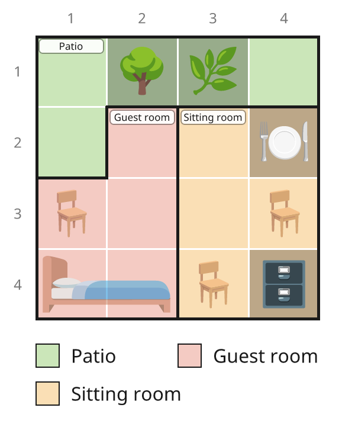
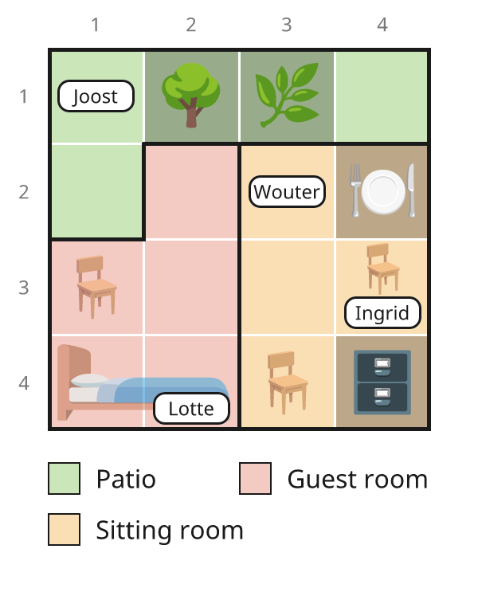
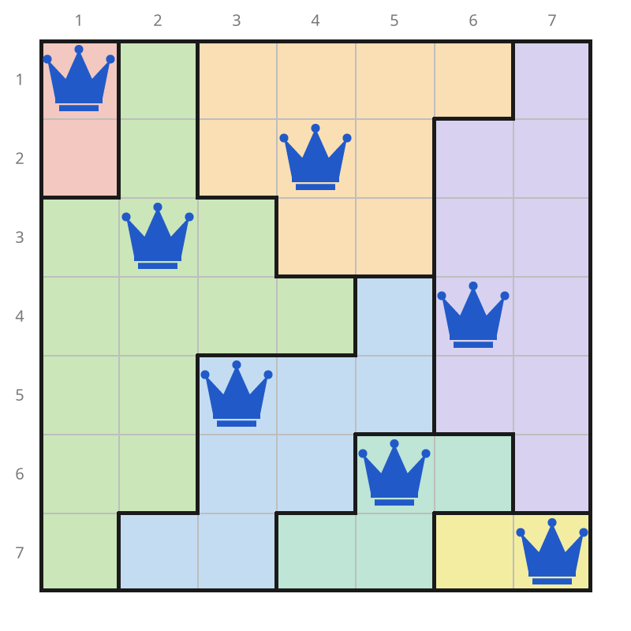

# Human Reasoning Puzzles

**Create, solve, play, and print original logic puzzles.**

[](https://operdeck.github.io/human-reasoning-puzzles/)

Explore a growing collection of playable and printable puzzles, from Sudoku,
Star Battle, and Zebra grids to custom Murdoku mystery series. An explainable
constraint engine powers the solver; Puzzle Lab helps create and validate new
puzzles from seeds and specifications, while dedicated Murdoku tools turn loose
clues and board sketches into original mysteries.

## Quick start

Requires Python 3.12+. Run directly with `uv`:

```bash
uv run csp examples/sudoku_1_4x4.txt
uv run csp examples/demo/murdoku_1_first_case.txt --explain
uv run csp examples/queens_6_4x4.txt --show-model
uv run csp examples/logicgrid_1_3x3.txt --brute-force
uv run csp examples/akari_1_6x6.txt --svg akari.svg
uv run csp examples/battleships_1_6x6_fleet.txt --explain
uv run puzzle-lab rate examples/queens_1_4x4.txt
uv run puzzle-lab search examples --family tango --tier hard
```

`--grade` reports the hardest deduction used. `--show-model` explains the compiled constraints. `--brute-force` checks uniqueness. `--explain` writes Murdoku narratives or Battleships deductions with named rules and reasons; `--svg [FILE]` draws the puzzle (and, once solved, the solution) as SVG with `uv sync --extra svg`; `--png` rasterises that same picture with `uv sync --extra png`, and `--svg --interactive` writes only the blank board, with cell ids for an app. `--export DIR` writes everything the [web player](#play-in-the-browser) needs: per puzzle a JSON bundle and the interactive board, plus an `index.json` (needs `uv sync --extra svg`; exits non-zero if any puzzle fails). Pictures use bundled icons and font only ([licences](src/csp/assets/NOTICE.md)), never the network. `--docx [FILE]` writes an editable Word booklet for one puzzle of any family, or for a glob such as `"examples/**/*.txt"` (puzzles first, then their solutions with the solved board and solving steps; needs `uv sync --extra docx`). Without puzzle files, `--docx` takes every Murdoku in `examples/` (not the test puzzles) and writes `booklet.docx`. `--pdf [FILE]` works the same way but writes a PDF (default `booklet.pdf` without puzzle files), converting that Word booklet with LibreOffice or, on macOS, Microsoft Word or Pages.

Browse the full [visual puzzle index](https://operdeck.github.io/human-reasoning-puzzles/).
For [collection and grading notes](docs/puzzle-collection.md), or the [model rules and file formats](docs/model-and-puzzle-formats.md), see the detail guides.
Use `puzzle-lab fresh`, `generate`, `rate`, `search`, and `audit` to create and validate non-Murdoku
examples; see the [authoring workflow](.github/skills/non-murdoku-puzzle-authoring/SKILL.md).
Murdoku retains its separate tools and skill.

Calcudoku examples and Puzzle Lab generation avoid single-cell cages. Older
files still work: a single-cell target is a clue whose digit you enter normally.
Use optional `--grade` with `fresh` or `generate` when preserving a specific
deduction technique, such as `--tier hard --grade cover3`.

The [Battleships examples](docs/model-and-puzzle-formats.md#battleships) now use complete fleets:
straight ships, no touching (including diagonals), line totals, and shaped
givens. The small 6x6 board is rated medium (`count`); the larger 8x8 board is
hard (`chains`). Both need the fleet rules, not just row and column arithmetic.
Generate another original board with
`uv run puzzle-lab fresh battleships --size 6 --tier medium --seed 136 --output /tmp/fleet.txt`.

## A first Murdoku case

Four people on a 4 × 4 floor plan with three rooms. Everyone stands in a
different row and column. Trees, bushes, tables, and cabinets block cells;
chairs and the bed are standable.

<table>
<tr><td></td><td>

**Clues**

1. Ingrid is on a chair.
2. Joost is next to the tree.
3. Lotte is on the bed.

**Wouter**, the victim, takes the last free square and is alone with the
murderer.

</td></tr>
</table>

For every playable example, see the [puzzle index](https://operdeck.github.io/human-reasoning-puzzles/). For
the complete syntax and supported rules, see [Model and puzzle formats](docs/model-and-puzzle-formats.md).

<details>
<summary>Show the worked solution</summary>

Joost is at r1c1. Lotte is at r4c2, so Ingrid can only be at r3c4. Wouter is
at r2c3. Wouter and Ingrid share the sitting room, so **Ingrid did it**.


</details>

## A few examples

The solver handles very different kinds of logic. Here are a few; [browse and play the full collection](https://operdeck.github.io/human-reasoning-puzzles/) or read the [collection and grading notes](docs/puzzle-collection.md).

<table>
<tr>
<td><strong><a href="examples/queens_3_7x7.txt">Queens</a></strong><br>Place one queen in each row, column, and region; queens may not touch.<br></td>
<td><strong><a href="examples/sudoku_9_4x4_kropki_consecutive_thermometers.txt">Kropki Sudoku</a></strong><br>Sudoku with adjacency dots and a thermometer.<br></td>
<td><strong><a href="examples/starbattle_2_8x8.txt">Star Battle</a></strong><br>Place stars by row, column, and region counts without touching.<br></td>
</tr>
<tr>
<td><strong><a href="examples/logicgrid_1_3x3.txt">Zebra logic grid</a></strong><br>Use clues to match items across categories.<br></td>
<td><strong><a href="examples/tents_3_4x4.txt">Tents and Trees</a></strong><br>Pair each tree with a tent, while satisfying line counts.<br></td>
<td><strong><a href="examples/akari_1_6x6.txt">Light Up / Akari</a></strong><br>Light every open cell without bulbs seeing each other.<br></td>
</tr>
</table>

## Play in the browser

`web/` is a small TypeScript + Vite player for every example, published to [GitHub Pages](https://operdeck.github.io/human-reasoning-puzzles/)
by `.github/workflows/pages.yml` on each push to `main` (repository Settings → Pages →
Source: GitHub Actions). Python stays the single source of truth: the player knows no
puzzle family, it only reads the bundles from `--export`. The index shows one
representative unsolved board preview per puzzle group (including each Murdoku
series), with compact puzzle links in one or two columns beside it. Select a
puzzle title to open its player.
Locally (Node 22.12 or later):

```sh
uv sync --extra svg
cd web && npm install
npm run export   # writes web/public/puzzles
npm run dev      # or: npm test, npm run build
```

Place a piece with a click or tap (or arrow keys and Space, or the piece's number key),
cross off a square with right-click, long-press or the Cross tool, and undo with Ctrl+Z.
Auto-mark crosses the squares a placement rules out (in Akari it lights what a bulb sees).
Digit puzzles take pencil marks: the Notes tool (key N) writes small digits, and auto-mark
hides any that a placed peer rules out. Progress is kept in the browser.
Conflicting placements or notes show the other cell and, when available, the
exported rule name; mistakes remain editable rather than being silently refused.
The Warnings toggle controls this feedback independently of Auto-mark. It is on
by default, and its setting is saved with each puzzle's progress.

## Licence

The code is Apache 2.0 (see `LICENSE`). The puzzles in `examples/` are **not**: they are
© Otto Perdeck, all rights reserved, and may not be copied or reused without the author's
explicit permission (see `examples/LICENSE.md`); playing them on this project's own site is
allowed. Generated `--docx` booklets and the web player carry this notice.
