# Human Reasoning Puzzles

**Play free logic puzzles online, and build your own with an explainable Python constraint solver.**

[](https://operdeck.github.io/human-reasoning-puzzles/)
[](https://operdeck.github.io/human-reasoning-puzzles/murdoku/)

**On iPhone:** open the site in Safari, tap Share and choose *Add to Home Screen*; it opens without Safari bars.

Explore playable and printable puzzles, from Sudoku, Queens and Star Battle to
Zebra grids and Murdoku mystery series. An explainable constraint engine solves the
way a person would with named deduction rules; Puzzle Lab creates and validates
puzzles, and a [typed Murdoku clue language](#a-murdoku-clue-language-that-says-what-you-mean)
expresses complex relations between people, areas and objects.

**For players:** Murdoku, Sudoku, Queens, Kakuro, Akari and more run in the browser with
notes and auto-marking. **For developers:** a Python 3.12 constraint engine, generator,
grader and TypeScript + Vite player, Apache-2.0.

## A first Murdoku case

Four people on a 4 × 4 floor plan with three rooms, one per row and column.
Trees, bushes, tables and cabinets block cells; chairs and the bed are standable.

<table>
<tr><td>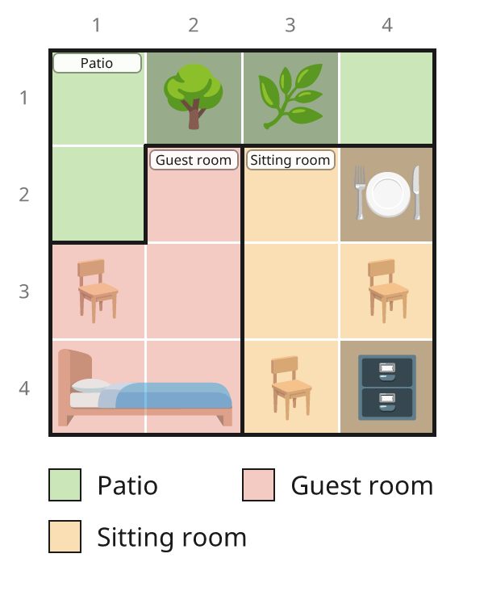</td><td>

**Clues**

1. Ingrid is on a chair.
2. Joost is next to the tree.
3. Lotte is on the bed.

**Wouter**, the victim, takes the last free square and is alone with the
murderer.

</td></tr>
</table>

<details>
<summary>Show the worked solution</summary>

- **The direct clues.** Ingrid is on a chair (1). Joost is beside the tree (2): **on the patio**: **Joost on r1c1**. Lotte is on the bed (3): **in the guest room**.

- By *r1c1 holds at most one person*, *exactly one person per row* and *exactly one person per column*, Joost takes column 1; therefore **Lotte on r4c2** is the only remaining place and **Joost occupies row 1 and column 1; exactly one person occupies each row and column, so no one else can use those lines**.

- By *r4c2 holds at most one person*, *exactly one person per row* and *exactly one person per column*, Lotte takes row 4; therefore **Ingrid on r3c4** is the only remaining place and **Lotte occupies row 4 and column 2; the one-person-per-line rule excludes everyone else**.

- By *r3c4 holds at most one person* and *exactly one person per row*, Ingrid takes row 3; therefore **Wouter on r2c3** is the only remaining place.

- **Answer.** Ingrid did it: she shares the sitting room with Wouter.

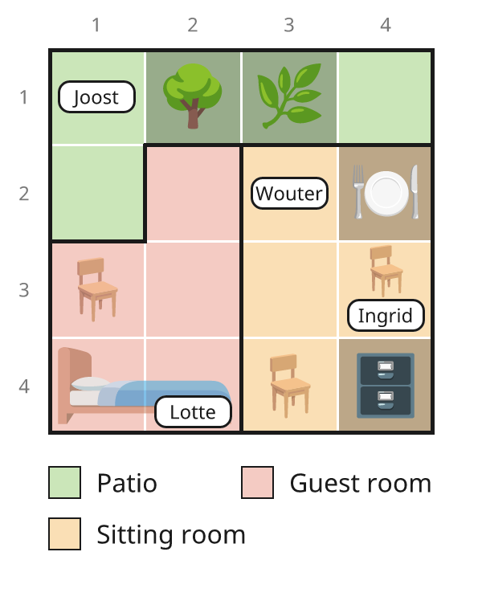
</details>

## Credits

**Murdoku is [Manuel Garand](https://murdoku.com)'s invention, not this project's.** He is a puzzle maker from Montréal, and his Murdoku books (Lannoo in Dutch, Union Square & Co. in English) are the real thing, so buy one and solve it with pen and paper. The puzzles here are the author's own, some written with AI help; they are an homage, not a replacement. Murdoku is a trademark of Digivoid Studios Inc., and this project is not affiliated with it.

## Quick start

Requires Python 3.12+. Run directly with `uv`:

```bash
uv run csp examples/sudoku_1_4x4.txt
uv run csp examples/demo/murdoku_1_first_case.txt --explain
uv run csp examples/queens_6_4x4.txt --show-model
uv run csp examples/akari_1_6x6.txt --svg akari.svg
uv run puzzle-lab rate examples/queens_1_4x4.txt
uv run puzzle-lab fresh starbattle --size 7 --stars 1 --tier easy --output /tmp/queens.txt
```

`--explain` writes a worked solution, `--grade` prints the hardest deduction used, `--show-model` explains the compiled model, `--brute-force` checks uniqueness, and `--svg`/`--png` draw the puzzle and its solution. Every other option is in [CLI options](docs/cli.md); generation, rating and validation are in the [non-Murdoku authoring skill](.github/skills/non-murdoku-puzzle-authoring/SKILL.md), Murdoku has its own skill, and file formats are in [Model and puzzle formats](docs/model-and-puzzle-formats.md).

## A Murdoku clue language that says what you mean

Murdoku clues are typed expressions over people, areas, rows, objects and marks,
so one clue can chain several relations. Each clue is type-checked, checked by an
independent brute force, and explained by the solver.

> The person on a horse stands in an area next to the area of whoever is on the
> traveller square.

```
some (people on object:horse) in (areas touches (area of (people on mark:traveller)))
```

Read it inside out: the traveller's area, then the areas sharing a side with it;
the outer `in` asks that the horse rider is in one of them. See
[Murdoku clue grammar](docs/murdoku-grammar.md).

## A few examples

<table>
<tr>
<td><strong><a href="examples/queens_3_7x7.txt">Queens</a></strong><br>Star Battle with one queen per row, column, and region; queens may not touch.<br>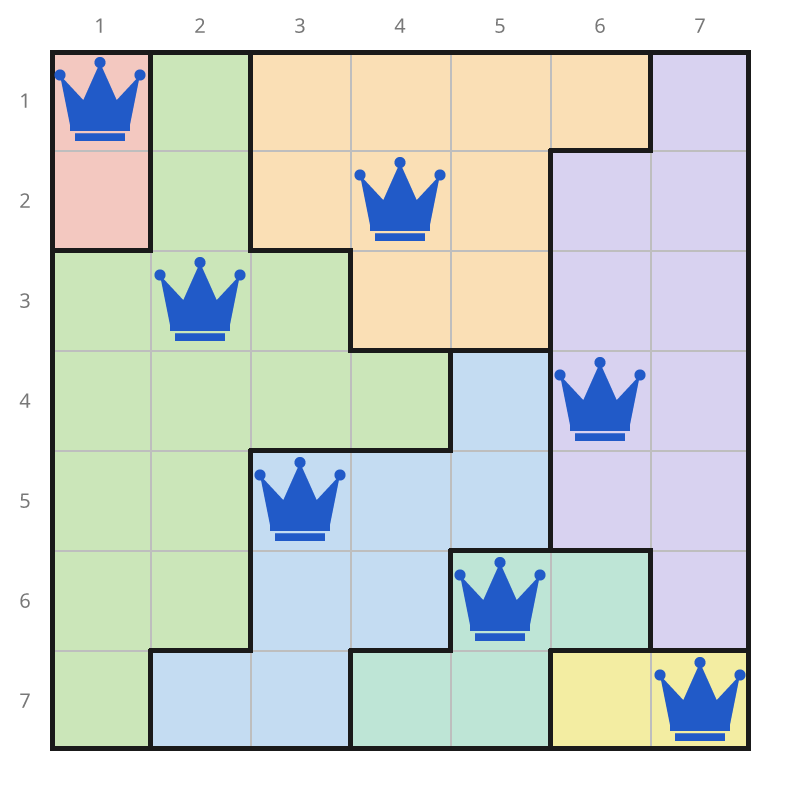</td>
<td><strong><a href="examples/sudoku_16_4x4_kropki_consecutive_thermometers.txt">Kropki Sudoku</a></strong><br>Sudoku with adjacency dots and a thermometer.<br>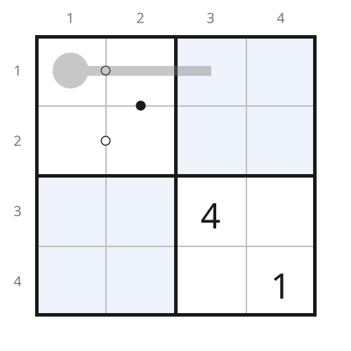</td>
<td><strong><a href="examples/starbattle_2_8x8.txt">Star Battle</a></strong><br>Place stars by row, column, and region counts without touching.<br>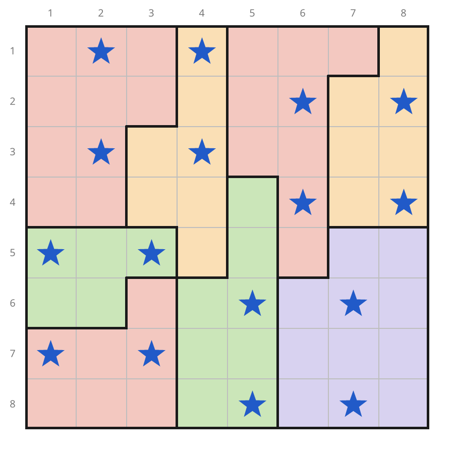</td>
</tr>
<tr>
<td><strong><a href="examples/logicgrid_1_3x3.txt">Zebra logic grid</a></strong><br>Use clues to match items across categories.<br>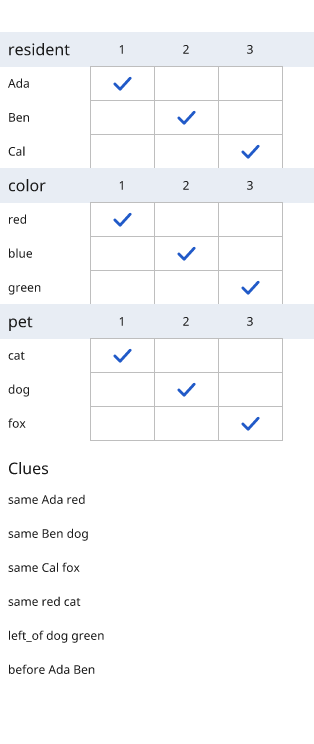</td>
<td><strong><a href="examples/tents_3_4x4.txt">Tents and Trees</a></strong><br>Pair each tree with a tent, while satisfying line counts.<br>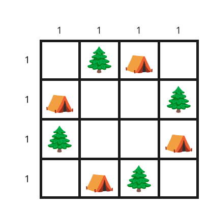</td>
<td><strong><a href="examples/akari_1_6x6.txt">Light Up / Akari</a></strong><br>Light every open cell without bulbs seeing each other.<br>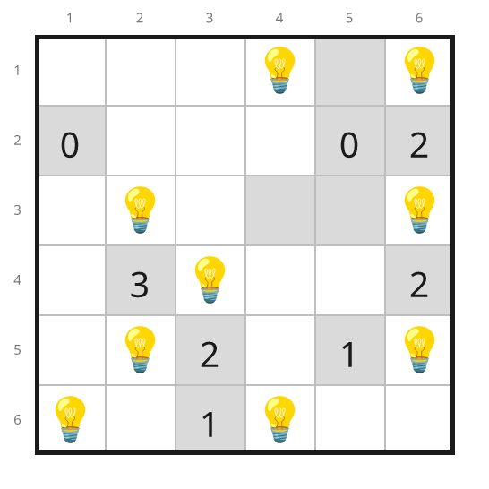</td>
</tr>
</table>

<table>
<tr>
<td><strong><a href="examples/towers_2_5x5.txt">Towers</a></strong><br>Each height once per row and column; an edge clue counts the towers you can see.<br>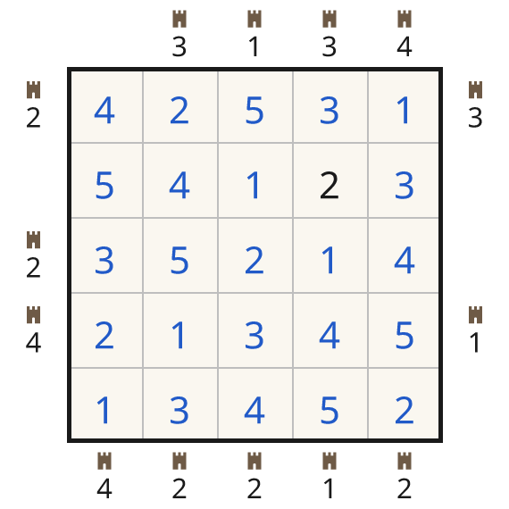</td>
<td><strong><a href="examples/mosaic_2_5x5.txt">Mosaic</a></strong><br>Black or white, so every number counts the black cells around it.<br>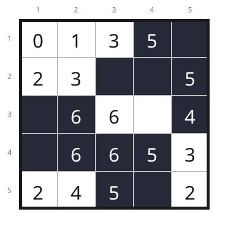</td>
<td><strong><a href="examples/dominosa_2_6x7.txt">Dominosa</a></strong><br>Cover the grid with dominoes, each pair of numbers used once; the numbers are pips, as on a stone.<br>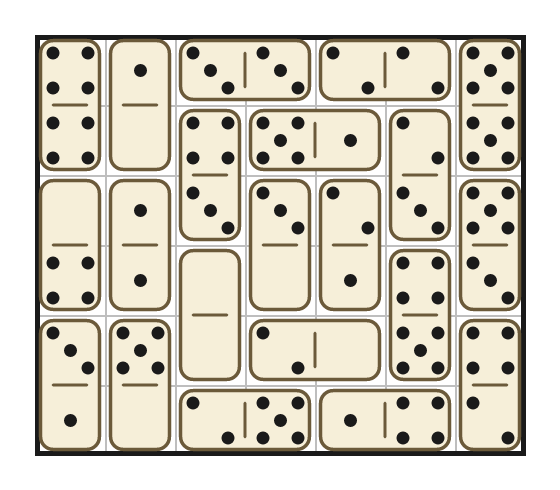</td>
</tr>
<tr>
<td><strong><a href="examples/rectangles_3_9x9.txt">Rectangles</a></strong><br>Cut the grid into rectangles, each holding one number equal to its area.<br>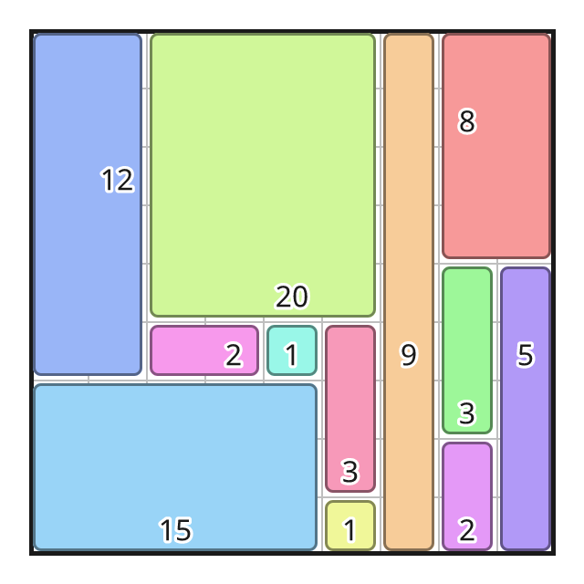</td>
<td><strong><a href="examples/magnets_3_6x6.txt">Magnets</a></strong><br>Place plus and minus poles so touching magnets repel and the counts match.<br>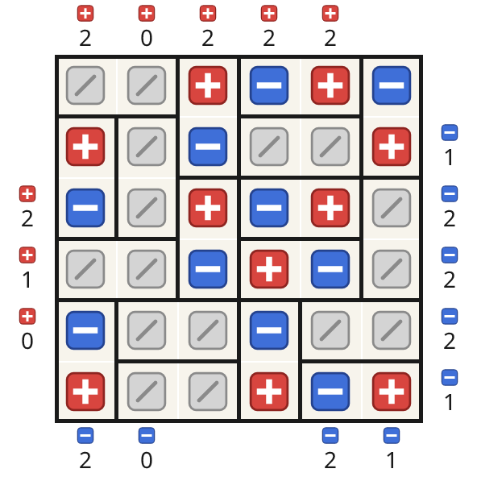</td>
<td><strong><a href="examples/undead_5_5x5.txt">Undead</a></strong><br>Ghosts, vampires and zombies seen along sight lines that bend at mirrors.<br>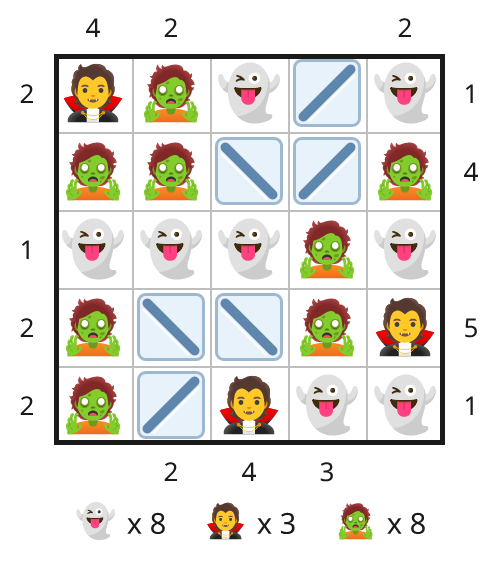</td>
</tr>
<tr>
<td><strong><a href="examples/pattern_2_8x8.txt">Pattern</a></strong><br>A nonogram: fill cells to match the run lengths of each row and column.<br>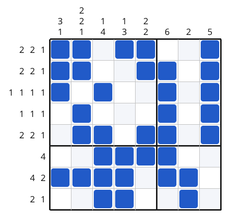</td>
<td><strong><a href="examples/map_3_9x9.txt">Map</a></strong><br>Four-colour the regions so no two neighbours share a colour.<br>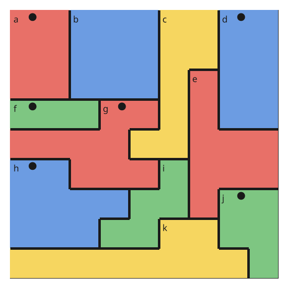</td>
<td><strong><a href="examples/thermometers_2_5x5.txt">Thermometers</a></strong><br>Fill each thermometer from its bulb so every row and column holds its count.<br>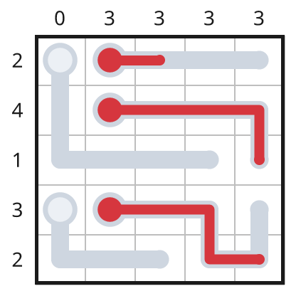</td>
</tr>
<tr>
<td><strong><a href="examples/kakuro_2_5x5.txt">Kakuro</a></strong><br>Digits 1 to 9 in runs that add up to their clue without repeating.<br>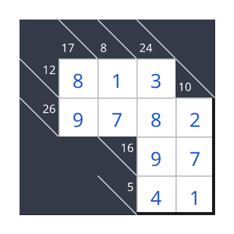</td>
<td><strong><a href="examples/hidato_2_5x5.txt">Hidato</a></strong><br>Write 1, 2, 3, … so every number touches the next; Numbrix allows only sides.<br>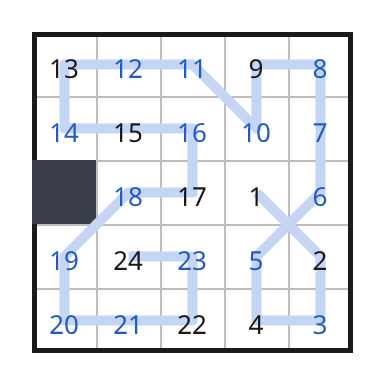</td>
<td><strong><a href="examples/killer_2_6x6.txt">Killer Sudoku</a></strong><br>Sudoku with caged sums; Arrow, Even/Odd, Sandwich and Skyscraper variants too.<br>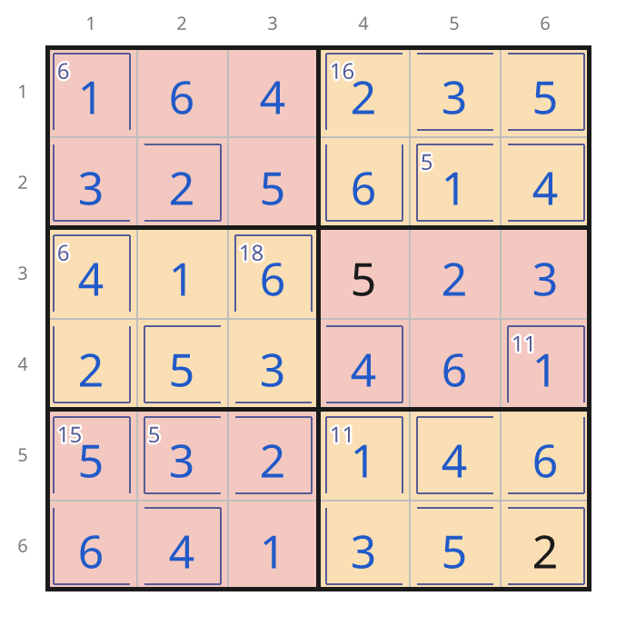</td>
</tr>
<tr>
<td><strong><a href="examples/rooms_2_5x7.txt">Rooms</a></strong><br>Give every person a room; people may share a room, rooms may stay empty, and a room never holds more than its capacity.<br>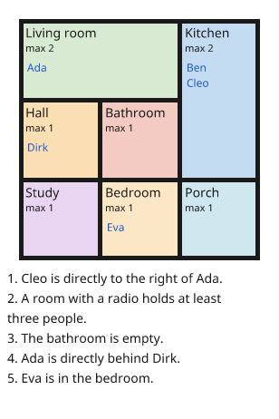</td>
</tr>
</table>

## Play Online

`web/` is a TypeScript + Vite player for every example, published to
[GitHub Pages](https://operdeck.github.io/human-reasoning-puzzles/) by
`.github/workflows/pages.yml` on pushes to `main`. Python is the single source of
truth; the player reads `--export` bundles. See [Web interface](docs/web-interface.md)
for setup, controls, notes, warnings and ground rules.

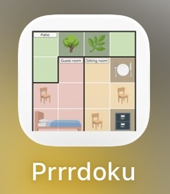

The same site installs as an iPhone home-screen app: open it in Safari, tap
Share and choose *Add to Home Screen*, and it opens without Safari bars. It also
plays offline after the first load: the build writes the manifest, the icons and
a service worker that precaches the app shell, the assets and every puzzle
bundle. See [Installable app](docs/web-interface.md#installable-app-pwa).

## Licence

The code is Apache 2.0 (see `LICENSE`). The puzzles in `examples/` are **not**: they are
© Otto Perdeck, all rights reserved, and may not be copied or reused without the author's
explicit permission (see `examples/LICENSE.md`); playing them on this project's own site is
allowed. Generated `--docx` booklets and the web player carry this notice.
