# Human Reasoning Puzzles

**An explainable constraint solver for many kinds of logic puzzles.**

Murdoku, Sudoku, Calcudoku/KenKen, Futoshiki, Queens-style / DogDoku, Tectonic/Suguru, Star Battle, Zebra logic grids, binary puzzles, and count-based grids all compile to one generic constraint engine.

## Quick start

Requires Python 3.12+. Run directly with `uv`:

```bash
uv run csp examples/sudoku_4x4.txt
uv run csp examples/demo/murdoku_first_case.txt --explain
uv run csp examples/queens_4x4.txt --show-model
uv run csp examples/logicgrid_3x3.txt --brute-force
uv run csp examples/akari_2x2.txt --svg akari.svg
```

`--grade` reports the hardest deduction used. `--show-model` explains the compiled constraints. `--brute-force` checks uniqueness. `--explain` currently writes Murdoku narratives; `--svg [FILE]` draws the puzzle (and, once solved, the solution) as SVG with `uv sync --extra svg`; `--png` rasterises that same picture with `uv sync --extra png`, and `--svg --interactive` writes only the blank board, with cell ids for an app. `--export DIR` writes everything the [web player](#play-in-the-browser) needs: per puzzle a JSON bundle and the interactive board, plus an `index.json` (needs `uv sync --extra svg`; exits non-zero if any puzzle fails). Pictures use bundled icons and font only ([licences](src/csp/assets/NOTICE.md)), never the network. `--docx [FILE]` writes an editable Word booklet for one puzzle of any family, or for a glob such as `"examples/**/*.txt"` (puzzles first, then their solutions with the solved board and solving steps; needs `uv sync --extra docx`).

For the full [example index and grade notes](docs/examples.md), or the [model rules and file formats](docs/model-and-puzzle-formats.md), see the detail guides.

## A first Murdoku case

Four people on a 4 × 4 floor plan with three rooms. Everyone stands in a
different row and column. Trees, bushes, tables, and cabinets block cells;
chairs and the bed are standable.

<table>
<tr><td></td><td>

**Clues**

1. Ingrid is on a chair.
2. Joost is next to the tree.
3. Lotte is on the bed.

**Wouter**, the victim, takes the last free square and is alone with the
murderer.

</td></tr>
</table>

For links to every example file, see [Puzzle examples](docs/examples.md). For
the complete syntax and supported rules, see [Model and puzzle formats](docs/model-and-puzzle-formats.md).

<details>
<summary>Show the worked solution</summary>

Joost is at r1c1. Lotte is at r4c2, so Ingrid can only be at r3c4. Wouter is
at r2c3. Wouter and Ingrid share the sitting room, so **Ingrid did it**.


</details>

## Puzzle overview

Each cell links to a representative example. The image shows the puzzle or its solution, whichever makes the rule easiest to see.

<table>
<tr>
<td><strong><a href="docs/examples.md#first-murdoku-case">Murdoku</a></strong><br><a href="examples/demo/murdoku_first_case.txt">first case</a><br></td>
<td><strong><a href="docs/examples.md#existing-families">Mini Sudoku</a></strong><br><a href="examples/sudoku_4x4.txt">4 × 4</a><br>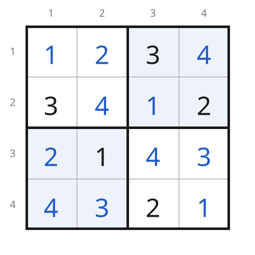</td>
<td><strong><a href="docs/examples.md#existing-families">Calcudoku</a></strong><br><a href="examples/calcudoku_4x4_easy.txt">4 × 4</a><br>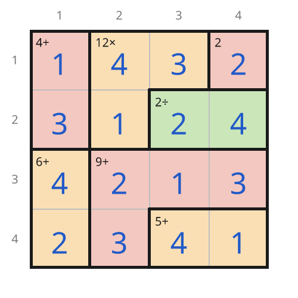</td>
<td><strong><a href="docs/examples.md#existing-families">Futoshiki</a></strong><br><a href="examples/futoshiki_5x5.txt">5 × 5</a><br>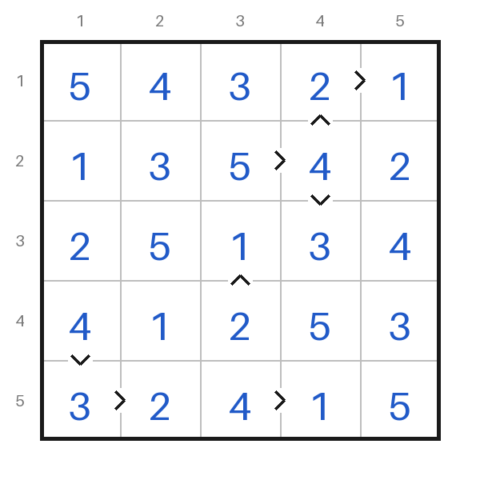</td>
</tr>
<tr>
<td><strong><a href="docs/examples.md#existing-families">Jigsaw Sudoku</a></strong><br><a href="examples/sudoku_jigsaw.txt">6 × 6</a><br>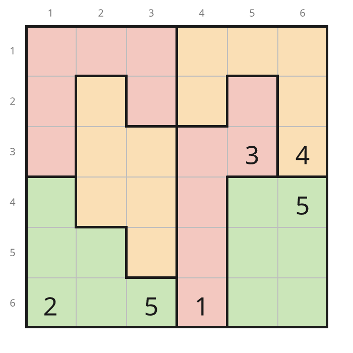</td>
<td><strong><a href="docs/examples.md#existing-families">X-Sudoku</a></strong><br><a href="examples/sudoku_x.txt">9 × 9</a><br>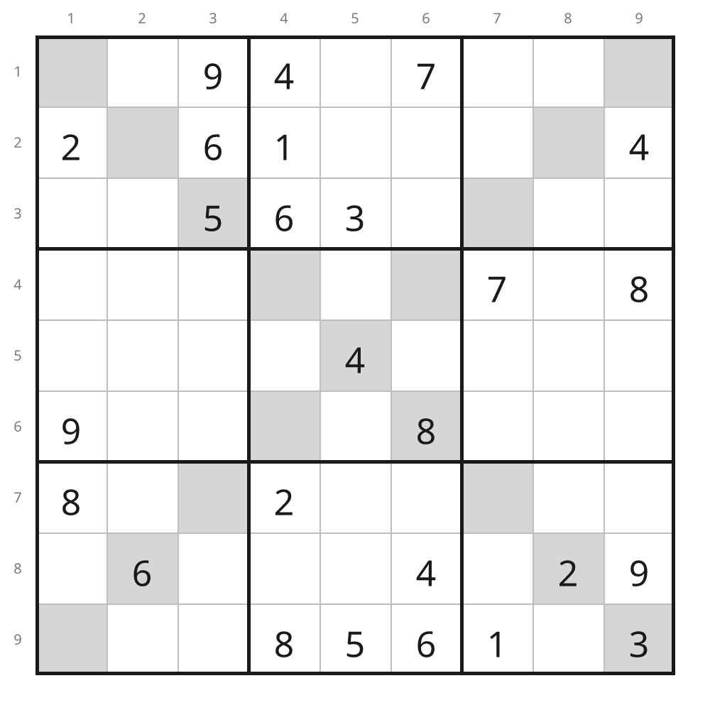</td>
<td><strong><a href="docs/examples.md#existing-families">NRC Sudoku</a></strong><br><a href="examples/sudoku_nrc.txt">9 × 9</a><br>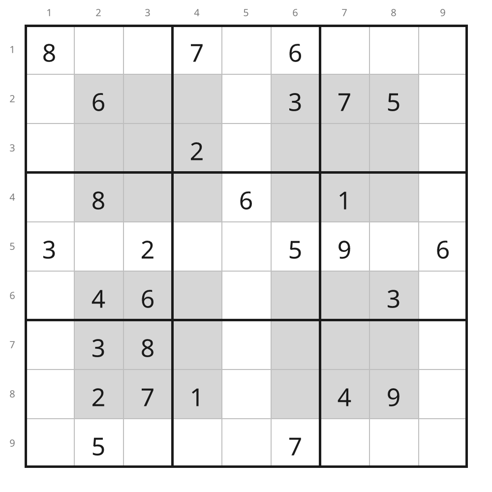</td>
<td><strong><a href="docs/examples.md#queens">Queens-style</a></strong><br><a href="examples/queens_4x4.txt">4 × 4</a> / <a href="examples/queens_8x8.txt">8 × 8</a><br>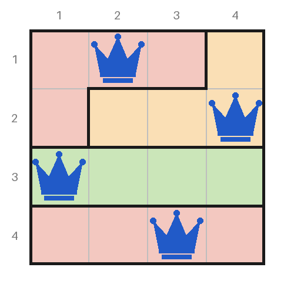</td>
</tr>
<tr>
<td><strong><a href="docs/examples.md#sudoku-relations">Kropki / thermometers</a></strong><br><a href="examples/sudoku_kropki_4x4.txt">4 × 4</a> / <a href="examples/sudoku_relations_9x9.txt">9 × 9</a><br>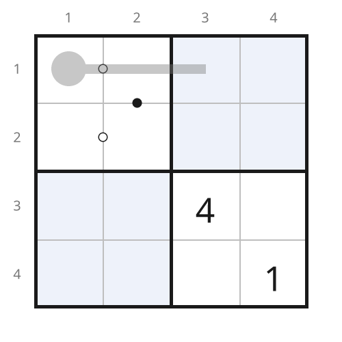</td>
<td><strong><a href="docs/examples.md#anti-knight">Anti-knight</a></strong><br><a href="examples/sudoku_anti_4x4.txt">4 × 4</a> / <a href="examples/sudoku_anti_9x9.txt">9 × 9</a><br></td>
<td><strong><a href="docs/examples.md#anti-king">Anti-king</a></strong><br><a href="examples/sudoku_antiking_6x6.txt">6 × 6</a> / <a href="examples/sudoku_antiking_9x9.txt">9 × 9</a><br>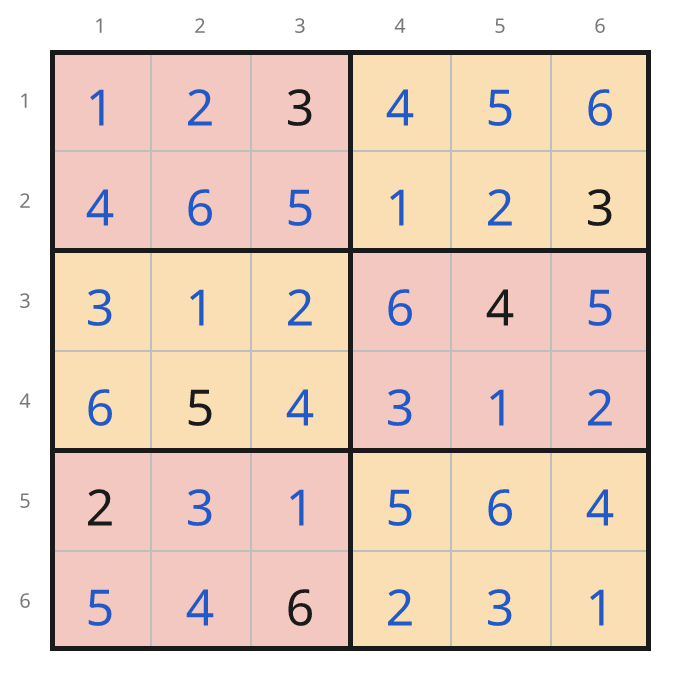</td>
<td><strong><a href="docs/examples.md#suguru">Tectonic / Suguru</a></strong><br><a href="examples/suguru_4x4.txt">4 × 4</a> / <a href="examples/suguru_8x8.txt">8 × 8</a><br>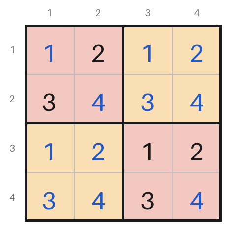</td>
</tr>
<tr>
<td><strong><a href="docs/examples.md#star-battle">Star Battle</a></strong><br><a href="examples/starbattle_8x8.txt">8 × 8</a> / <a href="examples/starbattle_10x10.txt">10 × 10</a> / <a href="examples/starbattle_12x12.txt">12 × 12</a><br></td>
<td><strong><a href="docs/examples.md#zebra">Zebra logic grid</a></strong><br><a href="examples/logicgrid_3x3.txt">3 × 3</a> / <a href="examples/logicgrid_6x6.txt">6 × 6</a><br>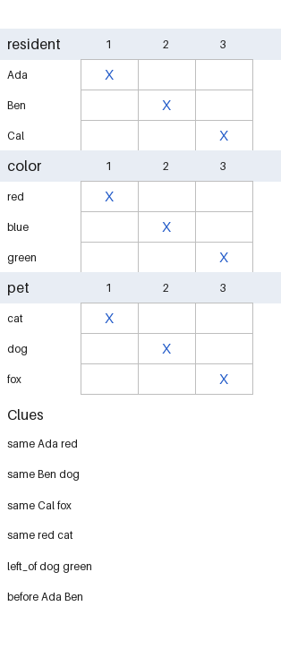</td>
<td><strong><a href="docs/examples.md#binairo">Binairo / Takuzu</a></strong><br><a href="examples/binairo_4x4.txt">4 × 4</a> / <a href="examples/binairo_8x8.txt">8 × 8</a><br>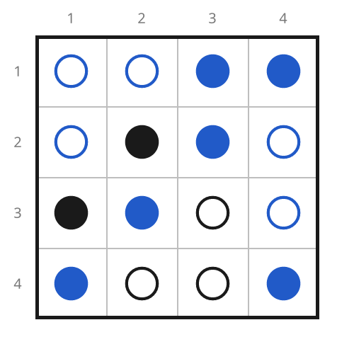</td>
<td><strong><a href="docs/examples.md#tango">Tango</a></strong><br><a href="examples/tango_4x4.txt">4 × 4</a> / <a href="examples/tango_8x8.txt">8 × 8</a><br></td>
</tr>
<tr>
<td><strong><a href="docs/examples.md#tents">Tents and Trees</a></strong><br><a href="examples/tents_4x4.txt">4 × 4</a> / <a href="examples/tents_8x8.txt">8 × 8</a><br>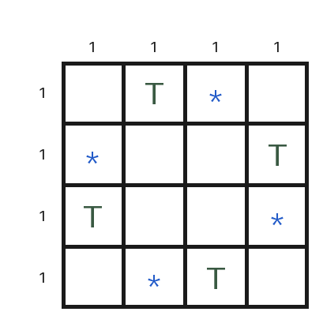</td>
<td><strong><a href="docs/examples.md#minesweeper">Minesweeper</a></strong><br><a href="examples/minesweeper_3x3.txt">3 × 3</a> / <a href="examples/minesweeper_8x8.txt">8 × 8</a><br>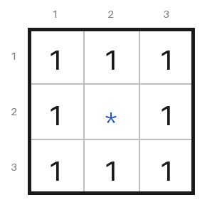</td>
<td><strong><a href="docs/examples.md#akari">Light Up / Akari</a></strong><br><a href="examples/akari_2x2.txt">2 × 2</a> / <a href="examples/akari_8x8.txt">8 × 8</a><br>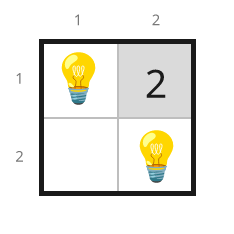</td>
<td><strong><a href="docs/examples.md#kakurasu">Kakurasu</a></strong><br><a href="examples/kakurasu_4x4.txt">4 × 4</a> / <a href="examples/kakurasu_8x8.txt">8 × 8</a><br></td>
</tr>
<tr>
<td><strong><a href="docs/examples.md#battleships">Battleships, counts only</a></strong><br><a href="examples/battleships_counts_4x4.txt">4 × 4</a> / <a href="examples/battleships_counts_8x8.txt">8 × 8</a><br></td>
<td><strong><a href="docs/examples.md#dogdoku">DogDoku</a></strong><br><a href="examples/dogdoku_5x5.txt">5 × 5</a> / <a href="examples/dogdoku_7x7.txt">7 × 7</a> / <a href="examples/dogdoku_9x9.txt">9 × 9</a><br>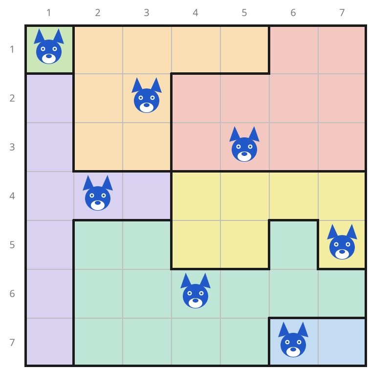</td>
<td></td><td></td>
</tr>
</table>

## Play in the browser

`web/` is a small TypeScript + Vite player for every example, published to GitHub Pages
by `.github/workflows/pages.yml` on each push to `main` (repository Settings → Pages →
Source: GitHub Actions). Python stays the single source of truth: the player knows no
puzzle family, it only reads the bundles from `--export`. Locally (Node 22.12 or later):

```sh
uv sync --extra svg
cd web && npm install
npm run export   # writes web/public/puzzles
npm run dev      # or: npm test, npm run build
```

Place a piece with a click or tap (or arrow keys and Space, or the piece's number key),
cross off a square with right-click, long-press or the Cross tool, and undo with Ctrl+Z.
Auto-mark crosses the squares a placement rules out (in Akari it lights what a bulb sees).
Digit puzzles take pencil marks: the Notes tool (key N) writes small digits, and auto-mark
hides any that a placed peer rules out. Progress is kept in the browser.

## Licence

The code is Apache 2.0 (see `LICENSE`). The puzzles in `examples/` are **not**: they are
© Otto Perdeck, all rights reserved, and may not be copied or reused without the author's
explicit permission (see `examples/LICENSE.md`); playing them on this project's own site is
allowed. Generated `--docx` booklets and the web player carry this notice.
