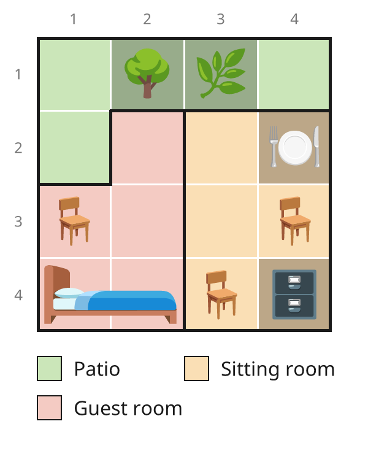
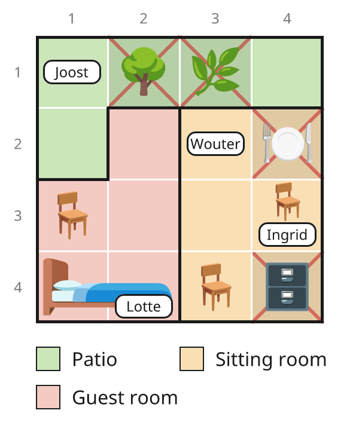
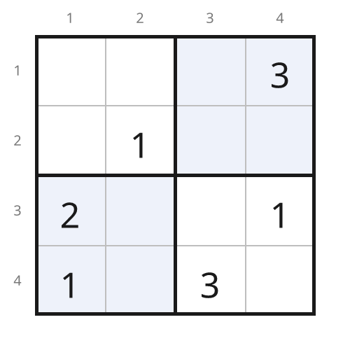
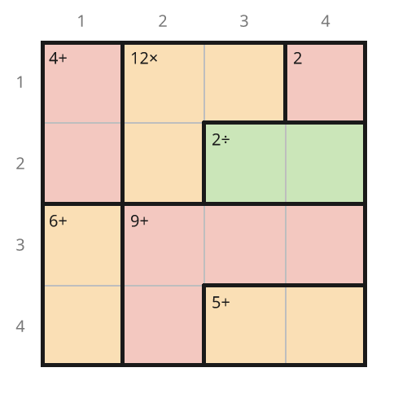
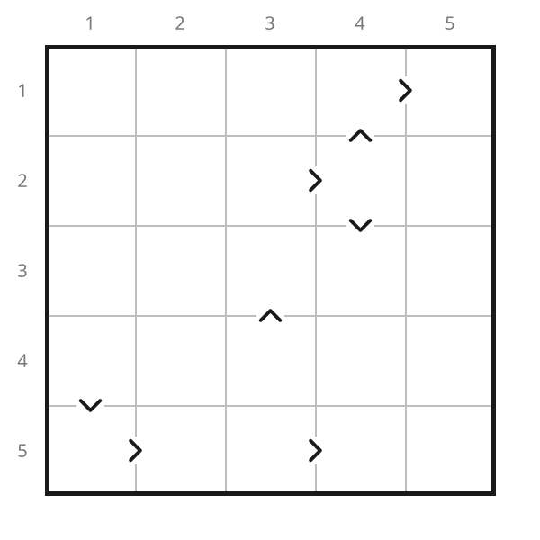

# prrrove

**Solves logic puzzles the way a person would, and writes down how.**

One small constraint engine, several puzzle families: **Murdoku** (any size),
**Sudoku** (with Jigsaw, X-Sudoku and NRC variants), **Calcudoku/KenKen** and
**Futoshiki**. Each puzzle is compiled down to literals
and constraints, and solved by named deduction rules — no search — so every
step can be explained. The rules never learn which puzzle they are solving.

## A first case

Four people on a 4 × 4 floor plan with three rooms. Everyone stands in a
different row and a different column. Trees, bushes, tables and cabinets
block their square; chairs and the bed can be sat or lain on. "Next to"
means directly above, below, left or right, *in the same room*.

<table>
<tr>
<td></td>
<td>

**Clues**

1. Ingrid is on a chair.
2. Joost is next to the tree.
3. Lotte is on the bed.

**Wouter**, the victim, is in the last free square.
He was alone with his murderer.

### Who did it?

</td>
</tr>
</table>

<details>
<summary><b>Show the solution</b>, as written by <code>--explain</code></summary>

<br>

- **The direct clues.** Ingrid is on a chair (1): r3c1, r3c4 or r4c3. Joost
  is next to the tree (2): **Joost on r1c1**. Lotte is on the bed (3): r4c1
  or r4c2.
- **Lotte, Ingrid and Wouter.** Joost takes column 1, so **Lotte on r4c2**.
  Lotte takes row 4 and Joost takes column 1, so **Ingrid on r3c4**. Only
  r2c3 is left for Wouter: **Wouter on r2c3**.



Wouter is in the sitting room, and the only other person there is
**Ingrid**. She did it.

</details>

Both pictures and the solution text are generated from
[`examples/murdoku_intro.txt`](examples/murdoku_intro.txt):

```bash
./solve.sh examples/murdoku_intro.txt --png              # beside the puzzle file
./solve.sh examples/murdoku_intro.txt --png board.png    # board.png, board-solution.png
./solve.sh examples/murdoku_intro.txt --explain         # the worked solution above
```

## Also Sudoku, Calcudoku and Futoshiki

The same engine, with the same kind of pictures. Givens are black; what the
solver fills in is blue.

<table>
<tr>
<th>Mini Sudoku</th>
<th>Calcudoku</th>
</tr>
<tr>
<td>Every row, column and 2 × 2 box holds 1–4 once.</td>
<td>Every row and column holds 1–4 once. Each cage's numbers make its
target with its sign: <code>9+</code> adds up to 9, <code>12x</code>
multiplies to 12, <code>2/</code> divides to 2.</td>
</tr>
<tr>
<td>
</td>
<td>
</td>
</tr>
</table>

```bash
./solve.sh examples/sudoku_4x4.txt --png sudoku.png           # sudoku.png, sudoku-solution.png
./solve.sh examples/calcudoku_4x4_easy.txt --png calcudoku.png
```

### Variants by generalising, not by new code

Many puzzle variants are an existing puzzle with its rules *generalised*:
more groups that must hold every digit once, or a different shape for them.
The engine never knew what a box was in the first place, so a variant is
only a few lines in the puzzle file and the compiler, with no new deduction
rule:

- **Jigsaw Sudoku**: boxes of any shape (`Boxes:`).
- **X-Sudoku**: the two main diagonals are houses too. They are written as
  two extra houses (below); the centre cell is on both.
- **NRC Sudoku** (also sold as Hyper Sudoku or Windoku), from the Dutch
  newspaper: four extra grey 3 × 3 boxes, overlapping the nine ordinary
  ones, follow the same rule (`Extra:`). Any other set of extra houses
  works the same way, X-Sudoku's diagonals included.
- **Futoshiki** is a Calcudoku without cages: the same Latin square, with
  one two-cell relation ("smaller than") per sign.

<table>
<tr>
<th>Jigsaw Sudoku</th>
<th>X-Sudoku</th>
<th>NRC Sudoku</th>
<th>Futoshiki</th>
</tr>
<tr>
<td></td>
<td></td>
<td></td>
<td></td>
</tr>
</table>

The X-Sudoku and the NRC Sudoku would each have two solutions without their
extra houses. A Futoshiki sign, being a two-cell relation, also gives
`chains` its links: the Futoshiki above has no givens at all and needs
`chains`.

Sudoku is 4 × 4 or 9 × 9, Jigsaw Sudoku and Futoshiki 4 × 4 to 9 × 9,
Calcudoku any size.

## What else it does

- **Explains itself.** `--explain` writes a short worked solution, in English
  or Dutch, citing clues by number and describing where people can be by
  room, row or column rather than listing squares. `--step` redraws the board
  after every deduction; `--show-model` shows what the engine sees.
- **Checks itself.** `--brute-force` solves by plain search, sharing nothing
  with the engine, to confirm a puzzle has exactly one solution. Every
  example is checked this way, and so is every single deduction the solver
  makes on it.
- **Grades puzzles** by the hardest rule they need (`--grade`), from
  `single` up to `chains` and `what_if`.
- **Draws the puzzle** (`--png`): Murdoku with region colours, icons and name
  tags; Sudoku, Calcudoku and Futoshiki with boxes, cages, targets and signs.

```bash
./solve.sh examples/prrrdoku3.txt --explain        # a 9 × 9 with three cats, in Dutch
./solve.sh examples/prrrdoku1.txt --step           # watch it deduce, step by step
./solve.sh examples/prrrdoku1.txt --track-person Vladimir
./solve.sh examples/sudoku_swordfish.txt --verbose
./solve.sh examples/calcudoku_6x6_hard.txt --show-model
```

Requires Python 3.12+. The solver has no runtime dependencies; `--png` needs
Pillow (`uv sync --extra png`).

## Command line

`./solve.sh <puzzle file> [options]` (or `uv run csp <puzzle file> [options]`). The puzzle type is
detected from the file; `--type sudoku|murdoku|calcudoku|futoshiki` overrides that.

| Option | What it does |
|---|---|
| *(none)* | Solve by deduction and print the start and end boards. |
| `--verbose`, `-v` | Narrate each deduction: the rule, what it placed or ruled out, and why. |
| `--step`, `-s` | Narrate, redraw the board, and wait for Enter after each deduction. Murdoku crosses out squares nobody can reach and lists whose options narrowed; Calcudoku and Futoshiki show the numbers still possible in each cell, like pencil marks. What changed is drawn in blue. |
| `--track-person NAME` | Murdoku only: show one person's live squares and region-overlap companion candidates after each deduction. The companion list is a conservative domain-overlap diagnostic, not a joint-solution check. |
| `--show-model` | Explain what the engine sees, then stop: variables, constraint families, how literals and constraints overlap, what the clues settled at compile time, each relation, and the rule ladder. The quickest way into the design. |
| `--brute-force` | Find the solutions by plain search instead of deduction, then stop. Exit code 0 if there is exactly one, 1 if there are none or several (it shows two and where they differ). The check to run after transcribing a puzzle. |
| `--explain` | Murdoku only: write out a short worked solution, as Markdown bullets, in the puzzle's language. See [Worked solutions](#worked-solutions). |
| `--grade` | Print only the puzzle's grade: the hardest rule the solve needed (`single` ... `chains`, `what_if`), or `unsolved`. |
| `--lint` | Murdoku only: check declarations and report missing icons, unreachable areas, and unused roles. Invalid puzzle data exits with code 1. |
| `--require-forward` | Murdoku only: run lint and require a solve without `what_if`; exit code 1 if forward rules stall. |
| `--png [FILE]` | Draw the puzzle to FILE, or default to `<puzzle-stem>.png` beside the input. A solved output adds `-solution` before the extension. |

Every solve ends with a summary such as `rules used: single 54, cover2 2;
grade: cover2`. Without `--brute-force` the exit code is 0 when the puzzle
is solved, 1 when the rules run out or hit a contradiction, and 2 when the
file cannot be read.

## Examples

| File | Needs |
|---|---|
| `sudoku_4x4.txt` | `single` only: the mini Sudoku above |
| `sudoku_easy.txt` | `single` only |
| `sudoku_pointing.txt` | `subsumption` (pointing pair) |
| `sudoku_naked_pair.txt`, `sudoku_hidden_pair.txt`, `sudoku_xwing.txt` | `cover2` |
| `sudoku_swordfish.txt` | `cover3` |
| `sudoku_chains.txt` | `chains` |
| `sudoku_x.txt` | `single` only, but it uses the diagonals: without them it has two solutions |
| `sudoku_jigsaw.txt` | `cover2`: a 6×6 with irregular boxes |
| `sudoku_nrc.txt` | `single` only, but it uses its four grey boxes: without them it has two solutions |
| `futoshiki_5x5.txt` | `chains`: no givens, eight signs |
| `murdoku_intro.txt` | `single` only: the 4×4 first case above |
| `murdoku_house.txt` | `relations`, `subsumption`: a 5×5 using "not next to" and a counting clue |
| `murdoku_sparse_mystery.txt` | `single`: a sparse 5×5 with role areas, standable objects, a door edge, and one murderer |
| `murdoku_global_counts.txt` | `single`, `count`: a unique 3×3 using all global-count selector families |
| `murdoku_composition.txt` | A neutral 4×4 composing tags, objects, edge/corner items, marks, roles, attributes, and counts |
| `prrrdoku1.txt` | `relations`, `subsumption` |
| `prrrdoku2.txt` | `what_if` |
| `prrrdoku3.txt` | `what_if` |
| `calcudoku_4x4_easy.txt`, `calcudoku_6x6_medium.txt` | `relations` (cage arithmetic) |
| `calcudoku_6x6_hard.txt` | `cover2` |
| `calcudoku_6x6_fiendish.txt` | `what_if` |
| `calcudoku_7x7_hard.txt` | `cover3` |

`prrrdoku1-3.txt` are based on the owner's Dutch puzzle documents (not in this
repo), with cats among the suspects. Their boards and clues are lightly
adjusted to preserve the intended solution while keeping Vladimir's location
and companion unresolved until the final placement. The graded Sudokus and
their variants, the Calcudokus and the Futoshiki are generated (newspaper
puzzles are copyrighted) and picked because each needs the rule listed. Every
one has exactly one solution.

## The model

Three ingredients, defined in `src/csp/core.py`:

- **Literals** — atomic choices. `r3c4=7` for Sudoku or Calcudoku,
  `Tim=r1c1` for Murdoku.
- **Constraints** — a set of literals with allowed true counts. The named
  `EXACTLY_ONE` and `AT_MOST_ONE` kinds retain their existing meanings;
  `COUNT` accepts any set of allowed totals and can be reified by a literal.
  Constraints may be labelled with the *family* they belong to ("each digit
  once per row"); the label only serves explanations.
- **Relations** — a predicate over two or more variables' choices, for clues
  like "Jos is somewhere left of Otto" or "Luna is furthest from Mao", and
  for Calcudoku cages ("these three cells add up to 12").

A *variable* is just a constraint flagged as owning a whole domain, so
`model.chosen("Tim")` can report what Tim settled on.

The `EXACTLY_ONE` / `AT_MOST_ONE` split is load-bearing, not decoration:
`AT_MOST_ONE` forbids a second truth but never forces a first. `COUNT` makes
the permitted true totals explicit with `allowed_counts`; it covers exact,
at-least, at-most, odd and even counts. With `reified_by`, a literal is true
exactly when the count is in that allowed set. Collapsing the legacy kinds
was the bug that made an earlier version unsound on Murdoku: with 7 people
over 43 squares, most squares stay empty, so "this square is only possible
for Vladimir" says nothing at all.

## How the puzzles map

| | Sudoku | Murdoku | Calcudoku | Futoshiki |
|---|---|---|---|---|
| Variable | a cell | a **person** | a cell | a cell |
| Literal | cell holds digit | person stands on square | cell holds number | cell holds number |
| `EXACTLY_ONE` | cell holds one digit | person stands somewhere | cell holds one number | cell holds one number |
| | digit once per row / col / box (/ extra house) | at most one person per row and column; full boards occupy each line | number once per row / col | number once per row / col |
| `AT_MOST_ONE` | — | square holds at most one person | — | — |
| Relations | — | position, distance and region clues; see [Puzzle files](#puzzle-files) | one per cage: its arithmetic | one per sign: smaller < larger |

A Calcudoku is a Sudoku without boxes plus one relation per cage. The cage
relation also requires distinct numbers where its cells share a row or
column, so arc consistency rules out "3+3" inside a line without help.
A Futoshiki is the same Latin square with one two-cell relation per sign.
Jigsaw boxes and extra houses (X-Sudoku diagonals, NRC boxes) are more
`EXACTLY_ONE` families, built
from one list of the puzzle's houses that the compiler, the brute force and
the pictures all share.

Murdoku's variables are people rather than squares because that is the shape
of the rules: at most one figure per row and column; when the board has as
many figures as rows, every row and column is occupied. Modelling it the Sudoku
way (squares choosing people) demands all people in each row and is
unsatisfiable the moment an object blocks a square.

## The rules

Applied cheapest-first; any success restarts the ladder.

| Rule | What it does |
|---|---|
| `single` | A final option in `EXACTLY_ONE`, or one remaining `COUNT` literal with a single feasible total, is forced true or false. |
| `count` | Propagate allowed true totals, including bounds, parity and reified counts. |
| `relations` | Arc consistency: drop every value of a relation that no combination of the other variables' values supports. |
| `subsumption` | A constraint requiring one additional true literal fills an outer constraint's remaining capacity and rules out its other options. |
| `cover2`, `cover3` | Disjoint inner constraints with total guaranteed demand *k* use up outer constraints with total remaining capacity *k*. |
| `chains` | Alternating inference chains. A *strong* link means a pair cannot both be false under the allowed counts; a *weak* link means they cannot both be true. Assume a start option false and follow strong and weak links in turn: an option reached as true means "the start or this one" holds, so anything weakly linked to both is false. Links come from actual count support or a two-variable relation. |
| `what_if` | Assume a literal on a copy, run `single`/`count`/`relations`/`subsumption`; if that contradicts, the literal is false. Of the options it can refute, it takes the one with the shortest refutation. |

`single` covers Sudoku's naked single *and* hidden single with no
special-casing — they are the same statement about different constraints
("this cell holds one digit" vs "this digit sits once in this row"). For a
general `COUNT`, `single` handles the last undecided literal and `count`
propagates the wider allowed set. `subsumption` is likewise pointing-pairs
and box/line reduction at once.

`cover`*k* is naked subsets (As are cells), hidden subsets (As are
digit-in-house), X-Wing (*k*=2) and Swordfish (*k*=3) (As are digit-in-row,
Bs digit-in-column) — one rule, again, with no special-casing. Its count
capacity proof also works when an inner constraint guarantees more than one
true literal.

`chains` is simple colouring, X- and XY-chains, Y- and W-wings and 3D
Medusa in one rule. Weak links from two-person clues and two-cell cages make
it work on Murdoku and Calcudoku as well. `--explain` tells a chain as "if
Otto is not on r6c5, then Otto is on r7c6, then Luna is not on r7c4 (row 7),
then Luna is on r8c3; so ...", with the reason for each link.

`what_if` is the case split a person does when stuck ("if Tim were on r2c3,
Jos would have nowhere to go"). It is last on the ladder and bounded: one
assumption, cheap rules only, no nested guessing. It looks at the variable
with the fewest options first and, of the values it can rule out there,
keeps the one whose contradiction comes quickest, so the explanation is as
short as it can be. Since `chains`, only
`prrrdoku3.txt` and the fiendish Calcudoku still need it.

### Related solvers

**A technique-by-technique solver.**
[Dedoku](https://github.com/n36l3c7/Dedoku) is a Sudoku solver with the same
philosophy: logic only, every step named and explained. It implements 20
technique families, each written for Sudoku's cells, rows and boxes, and it
inspired several things here: the `chains` rule, the step-by-step soundness
test, grading and the benchmark. Because this engine sees only literals and
count constraints and relations as generic primitives, many of those families are one rule here:

| Sudoku techniques | Here |
|---|---|
| Naked and hidden singles | `single` |
| Pointing and claiming (intersection removal) | `subsumption` |
| Naked and hidden pairs and triples, X-Wing, Swordfish | `cover2`, `cover3` |
| Simple colouring, X-Chain, XY-Chain, Y-Wing, W-Wing, 3D Medusa, AIC | `chains` |
| Quads, Jellyfish, finned fish, ALS-XZ, XYZ-Wing | not yet; see [Possible improvements](#possible-improvements) |
| Unique and Avoidable Rectangles, BUG | not planned: they assume the puzzle has exactly one solution, while every rule here must be sound for any model |

**A solver with no named techniques at all.**
[Demystify](https://github.com/stacs-cp/demystify), from the University of
St Andrews, is generic in a different way. Puzzles are written in a
constraint modelling language (Essence Prime), with an English description
attached to each constraint. At every step it searches, with a SAT solver,
for the smallest set of constraints that proves some cell value impossible
(a *minimal unsatisfiable subset*), takes the step with the smallest such
set, and explains it by listing those constraints. It covers many puzzle
types (Futoshiki, Kakuro, Skyscrapers, Star Battle, Binairo and more), and
its paper reports its steps matching published human solving guides about
89% of the time. This engine sits in between: named rules, cheap and
dependency-free, but none of them written for one puzzle.

## Verification

```bash
uv run pytest -q
uvx ruff check src tests benchmark      # lint
uvx ruff format --check src tests benchmark   # formatting
uv run mypy src                         # strict type check
```

GitHub Actions runs all four on every push to `main`, on Python 3.12 and
3.13.

Correctness is checked against ground truth, not self-consistency:

- **Brute force.** `csp.bruteforce` solves every puzzle family by plain
  backtracking, with no literals, constraints or deduction rules. It shares
  only the file readers and the puzzle's rule definitions (Calcudoku cage
  arithmetic, Murdoku clue `conditions`) with the engine, and a test checks
  it never imports `csp.core`. Every example must have exactly one
  brute-force solution, and the engine must find that same solution.
  `--brute-force` runs it from the command line; exit code 0 means the
  puzzle is unique, so it is the check to run after transcribing a puzzle.
- **Every step.** On every example, every placement and every elimination
  the solver logs, compile time included, is checked against the
  brute-force solution. A rule that ever removes a true option fails this.
- The graded Sudokus (`sudoku_pointing`, `_naked_pair`, `_hidden_pair`,
  `_xwing`, `_swordfish`, `_chains`) and Calcudokus must also show their
  named pattern in the log, and must stall when the ladder is cut just
  before their rule, so each example really exercises that rung.
- `prrrdoku1-3.txt` are checked against the intended source solutions and the
  answer to the question of who is in Vladimir's region. Tests cover the
  unchanged candidate lists, the deliberate late-reveal changes, and the
  final placement and companion.
- Calcudoku solutions are also checked as properties: every row and column
  is a permutation, and every cage makes its target.

### Benchmark

`uv run python benchmark/run.py --count 30 --seed 42` generates seeded random
Sudokus, each made minimal (no given can go without losing uniqueness,
checked by brute force), then grades and times them:

| Grade | Puzzles | Median ms | Max ms |
|---|---:|---:|---:|
| `single` | 13 | 11.4 | 12.7 |
| `subsumption` | 7 | 20.3 | 33.9 |
| `cover2` | 1 | 19.6 | 19.6 |
| `chains` | 9 | 833.8 | 2006.1 |

All 30 are solved by logic. Without `chains`, `what_if` had to settle nine
of them; with it, none. Chains are the slow part: the links are rebuilt from
scratch every time the rule runs (see below).

## Puzzle files

Sudoku is a plain 4 × 4 or 9 × 9 grid; `.`/`0` are blanks, and `|`/`-` are
ignored. For the variants, put the grid under `Givens:` and add:

```
Givens:
. . . . 3 4      # any size 4 to 9 when Boxes: is given
...
Boxes:           # Jigsaw: a letter per cell; N boxes of N cells each
a a a b b b
a c a b d b
...
Extra:           # extra houses of N cells: per cell '.' or its house letters
x . . . . . . . y
. x . . . . . y .
...
. . . . xy . . . .
...
```

The `Extra:` above is X-Sudoku: diagonals `x` and `y`, the centre cell on
both. NRC Sudoku marks its four grey boxes `a` to `d` the same way; see
[examples/sudoku_x.txt](examples/sudoku_x.txt) and
[examples/sudoku_nrc.txt](examples/sudoku_nrc.txt).

Futoshiki is a grid of givens and dots, then one sign per line between
neighbouring cells (either way round):

```
Grid:
. . . . .
...
Signs:
r1c4 > r1c5
r1c4 < r2c4
```

Calcudoku names each cage with a letter on the grid, then gives its rule:

```
Size: 4
Grid:
a a b c
d e b c
d e f f
g h h i
Cages:
a: 3-          # difference; 2-cell cages only
b: 7+          # sum
c: 2/          # quotient, larger first; 2-cell cages only
h: 3x          # product; also *, ×
g: 4           # one-cell cage: the number itself
```

The typographic signs ×, − and ÷ are accepted as printed. Cages must be
connected, and every cage on the grid needs a rule.

Murdoku uses named sections — see `examples/prrrdoku*.txt`:

```
Size: 7
Language: nl    # optional; language of --explain (en or nl, default en)
Words:          # optional; how --explain names things
  water: in het water     # a region or area tag: where it is
  vuurtje: het vuurtje    # an object type: what it is called
Regions:        # id: name [#RRGGBB], e.g. "a: keukenwinkel #FADFB5" (name without spaces)
AreaTags:       # optional; tag: region_name region_name ...
Attributes:     # optional; attribute: person ...; unlisted people do not have it
  glasses: Anja Blake
Pronouns:       # optional; person: subject object possessive
  Anja: she her her
Hatched:        # optional; regions or area tags drawn hatched in pictures
Grid:           # region id per square, e.g. "a a b b c c c"
Objects:        # name: blocking|standable square...; repeat a name for more instances
  tree: blocking r1c1
  rug: standable r3c2 r3c3  # a connected multi-cell footprint
  chair: standable r4c4    # another instance of the same object type
EdgeItems:      # optional; doors touch two cells, windows one; neither occupies a cell
  gate: door r4c5 r4c6
  window: window r2c3
CornerObjects:  # optional; object touches the four cells around an interior grid corner
  fountain: r3c3 r3c4 r4c3 r4c4
Marks:          # optional; named cell sets may overlap and never block a cell
  quiet: r2c3 r2c4 ; alone
  gathering: r3c1 r3c2 ; not_alone
Roles:          # optional; roles overlap unless a rule says otherwise
  bandit: 4 different_regions
  bearded: 6
  scout: any
RoleEligibility: # optional; restrict a role to these people
  bandit: Anja Blake Colin
  scout: attribute:glasses
People:         # one per line, from 1 through Size
Rules:          # optional; clues that come with the board, not numbered
  outside Tim water
Clues:          # numbered 1, 2, ... in the order given
  next_to Tim klimwand               # shares a side in the same region; not diagonal
  not_next_to Ben lamp               # no side-sharing neighbor in the same region
  at Tim window                      # exactly a cell touched by a door or window
  next_to Jos fountain               # one of the four cells around a corner object
  on_mark Ada quiet                  # Ada occupies a cell marked quiet
  not_on_mark Ben gathering          # Ben occupies no gathering cell
  not_on_mark Eli quiet gathering    # no cell carrying either mark
  has_attribute Anja glasses
  not_attribute Colin glasses
  unique_attribute glasses Anja Blake Colin
  has_role Ada bandit                # known membership
  not_role Ben bandit                # explicitly absent membership
  some_role Eli                      # at least one role, not yet named
  roleless Faith                     # no roles
  at_most_one_role Gerald            # explicit per-person limit
  role_subset bandit bearded         # every bandit is bearded
  role_subset scout attribute:glasses # typed person-attribute selector
  role_in_tagged Anja bandit inside  # this role requires the tagged area
  role_not_in_tagged Blake bandit inside
  min_role_in_tagged bandit inside 1 # every region in the tag has a holder
  role_on Anja bandit chair          # role binding to object or mark cells
  role_next_to Blake bandit blocking # role binding to an object kind
  role_below Colin bandit 1          # exactly one row below a role holder
  sole_role_companion Daryl bandit
  role_occupant bandit not_alone      # condition in each area with a bandit
  in_row Tim 3
  not_in_row Jos 1
  in_column Ada 4
  not_in_column Ben 2
  in_area_corner Anja inside         # corner cell of a region carrying the tag
  adjacent_regions Ada Ben           # different regions that share a side
  alone_with Ada role:bandit         # exactly one companion, who holds the role
  above Ada area:kitchen             # Ada is above someone in the named area
  left_of Ben tag:inside             # quantified targets can name area tags
  within Cal object_kind:standable 3
  same_region Eli mark:quiet         # quantified targets can name cell sets
  knight_from Tim klimwand boulder   # a knight's move from any of them
  on Jos bank                        # on a standable object
  not_on Clarence stoel              # not on any square in that standable set
  only_on Anna bed                   # Anna is on it; nobody else is
  in_corner Henriette                # one of the four grid corners
  in_region Jos keukenwinkel         # any number of named regions
  outside Pip water                  # none of the given regions
  in_tagged Ada shoreline            # any region carrying this area tag
  not_in_tagged Ben restricted       # none of the regions with this tag
  same_region Anna Jos
  different_region Anna Pip
  apart Luna Mao                # different regions that do not share a side
  above Otto Tjitske 1          # exactly 1 row above; omit n for anywhere above
  left_of Jos Otto                   # anywhere left of Otto
  left_of Gideon Katharina 1         # exactly one column left
  within Tjitske Otto 4         # at most 4 orthogonal steps apart
  at_least Tim Pip 6            # at least 6 steps apart
  alone Luna                    # nobody else in Luna's region
  furthest Luna Mao             # Luna is strictly further from Mao than anyone
  exactly 1 in_region Ada study ; in_region Ben hall   # exactly n of these hold
    count people on object:bed = 1
    count people on object_kind:standable = 1
    count people in area:kitchen >= 2
    count people in rows:1,3 = 2
    count people in columns:2-4 <= 3
    count people with role:bandit odd
    count people with attribute:bearded = 3
    count empty areas all = 0
    count empty areas in tag:inside = 1
    count empty cells in mark:quiet 2..4  # inclusive range
```

Every object declaration must say `blocking` or `standable`; names and icons do
not imply occupancy. Repeat a name to place multiple instances of one object
type. Each declaration is one connected, non-overlapping footprint.

`Roles:` declares theme-neutral role names with optional exact holder counts;
use `any` when the role has no global count. `different_regions` requires role
holders to occupy distinct logical areas. `RoleEligibility:` restricts a role
to its listed people. Role membership is independent by default, so a person
may have several roles or none; use `at_most_one_role` only when required.
Undecided membership remains unknown until a clue or constraint determines it.

`Attributes:` declares fixed person traits as `attribute: person ...`; unlisted
people do not have the attribute. Use `has_attribute` or `not_attribute` for a
direct clue, and `unique_attribute <attribute> <people...>` to require exactly
one selected person to have it. `RoleEligibility:` accepts `attribute:name`,
and `role_subset` accepts bare role names or typed `attribute:name` and
`person:name` selectors.

`Pronouns:` optionally gives each person subject, object, and possessive forms
for `--explain`, such as `Ada: she her her`. People without an entry use
`they them their`.

Quantified targets use an explicit prefix to avoid confusing people, roles,
traits, and places: `person:name`, `attribute:name`, `role:name`, `area:name`,
`tag:name`, `object_kind:standable`, `object:name`, `mark:name`,
`edge_item:name`, or `corner_object:name`. A bare known person is also accepted.
`alone_with <person> <target>` requires exactly one other person in the same
region, and that companion must match the target. Pair clues such as
`above <person> <target>`, `left_of`, `within`, and `adjacent_regions` can use
the same target selectors.

`Marks:` gives names to cell sets independently of regions and objects. Marks
may overlap, and marked cells remain open for people. `on_mark` and
`not_on_mark` query a mark set. An optional `; alone` or `; not_alone` condition
applies only if someone occupies a marked cell; it then counts all occupants
of that cell's logical area. `alone` allows one occupant, while `not_alone`
requires at least two.

`alone` and `furthest` expand to one relation per other person; `furthest`
is a three-way relation (Luna, Mao, that person).

`AreaTags:` assigns reusable tags to named regions. Tags may overlap, and a
tag may cover disconnected regions. `in_tagged` and `not_in_tagged` are clue
filters; use `only_in_tagged` and `not_in_tagged` in `Rules:` for per-person
required, forbidden, or unrestricted area policies. `Hatched:` accepts either
region names or area tags.

`exactly n <clue> ; <clue> ...` counts simple, named-person clues. Together they
may name at most three people: the engine checks a relation by trying every
combination of its people's squares, which grows quickly. Quantified-target
clues and `alone_with` cannot be nested inside `exactly`; `only_on` is also a
group restriction and cannot be nested.

`count` adds whole-board clues using the existing `COUNT` constraint. Comparisons
are `= n`, `<= n`, `>= n`, `odd`, `even`, or an inclusive `low..high` range.
`people on` selects cells of an object type or object kind; `people in` accepts
an area, tag, row/column list or range, object, or mark; `people with` accepts a
role or attribute. `empty areas all` counts logical regions with no occupants;
`empty areas in tag:name` counts empty regions in the tagged set once, even if
tags overlap. `empty cells in` counts unoccupied, non-blocked cells in a set.

People counts include every entry in `People:`, including a victim if listed;
there is no implicit suspects-only subset. Attributes are fixed puzzle data, so
a count of people with an attribute validates consistency but cannot deduce a
location. Role counts can constrain role membership and location rules tied to
those roles. Empty areas and empty cells use reified zero-occupancy literals.

`--show-model` lists each global clue as its own `COUNT` constraint with the
selected literals and allowed totals. `--step` shows true/open totals, how many
more are needed, feasible totals, and highlights selected cells; `--explain`
words count deductions and names area
capacity; `--png` lists global clues and outlines their cell scopes. A global
count adds one count over selected person/cell literals, plus one hidden empty
indicator per logical area or selected free cell; it does not create a relation
over all people. The 12×12/16×16 benchmark is reproducible with
`uv run python benchmark/murdoku_global_counts.py --runs 3`.

On the current Python 3.12 environment, three-run medians were:

| Board | Parse ms | Compile ms | `single`/`count` ms | `single`/`count`/`chains` ms | Constraints | Literals |
|---:|---:|---:|---:|---:|---:|---:|
| 12×12 | 0.23 | 3.62 | 2.12 | 15,336.98 | 211 | 904 |
| 16×16 | 0.31 | 8.19 | 4.58 | 187,982.30 | 337 | 2096 |

Chains are expensive on this synthetic count-heavy workload: the 16×16
count-plus-chains median is about 3.1 minutes, compared with 4.56 ms for
count-only propagation.

Quantified location clues stay bounded: each target is checked against one
candidate person at a time, with at most four variables in a relation (subject,
candidate, role membership, and witness). The compiler adds at most one such
relation per other person plus one count constraint; it does not build a
relation over every person's square at once.

There is no "two people next to each other" clue: with at most one person per
row and column, two people never share a side, so it could never hold.

For ordinary objects, `next_to` means one orthogonal step (up, down, left, or
right) from an object cell in the same logical area. Diagonal cells do not
count. A door lists two orthogonally neighboring cells in different areas;
either cell satisfies `next_to` or `at`, including across the boundary. Wider
openings are multiple simple doors with the same name. A window lists one cell
for `at`; a corner object lists the four cells around its interior grid vertex
for `next_to`. These items touch cells but do not occupy or block them. Distance (`within`,
`at_least`, `furthest`), direction (`above`, `left_of`) and `knight_from` may
cross region boundaries.

### Worked solutions

`--explain` writes the kind of solution a puzzle booklet prints: one bullet
per placement (or run of placements), clues cited by number, and people's
options described by region, row, column or the things on the board, with
square numbers only when there are a few:

> **Tjitske.** Otto en Pip zijn in hetzelfde gebied (7). Otto zit in een
> klimgebied of op kantoor, dus Pip zit in een klimgebied of op kantoor.
> Luna is ergens boven Jos (10), dus Jos zit op r8k3 of r8k4 en Luna zit in
> rij 6 of 7. ... Luna kan alleen in kolom 1, daar kan verder niemand:
> **Tjitske op r5k2**.

It is built in three layers that never reach into each other:

1. The solver solves as usual; each logged step records structurally *why*
   (which constraints or relation, which placement, a what-if's trail).
2. `proof.shortest` turns each deduction into a replayable `Move` and drops
   moves, hardest (`what_if`) first, while the rest still solve the
   puzzle; placements of someone with one option left are free.
   `proof.essential` trims a what-if to the steps its contradiction needed.
3. `story` words what is left, in the language and words of the puzzle
   file. A test checks that every placement it states matches the brute
   force.

### Pictures

`--png` draws a Murdoku board from the puzzle file in the style of a printed
Murdoku: region colours (from `Regions:`, or a default palette), a darker shade
under objects, hatching where `Hatched:` says, thick lines between regions,
icons for named objects, door marks, window and corner-object icons, marked-cell
badges and legend entries, name tags for people, coordinates and a
legend. Because it is drawn from the same file the solver reads, the picture
cannot disagree with the puzzle. Sudoku, Calcudoku and Futoshiki pictures
share the look: thick lines around boxes or cages, alternate boxes shaded,
Jigsaw boxes and cages in pastels that never match a neighbour, each cage's
target in its corner, extra houses (X-Sudoku diagonals, NRC boxes) grey as
NRC prints them, and each Futoshiki sign
drawn as a chevron on the cell edge.

Icons are referenced, not stored in the repo: `src/csp/icons.py` maps object
names (Dutch and English, e.g. `koffer`/`suitcase`; `boom2` counts as `boom`)
to Unicode emoji code points, and the pictures come from Google's
[Noto Emoji](https://github.com/googlefonts/noto-emoji) (images under the
Apache License 2.0), pinned to one commit so a name always gives the same
picture. They are downloaded on first use into `~/.cache/csp-solver`
(override with `CSP_ICON_CACHE`). An object not in the catalogue, or any
object when offline, is drawn as its name. To add an object, add its name
and code point to `CATALOGUE`.

## Layout

```
src/csp/
  core.py        engine: literals, constraints, relations, rules, solver
  proof.py       a short replayable proof of a solve (any puzzle family)
  sudoku.py      Sudoku compiler + renderer, including Jigsaw, X-Sudoku and NRC
  calcudoku.py   Calcudoku/KenKen compiler + renderer with pencil marks
  futoshiki.py   Futoshiki compiler + renderer with pencil marks
  murdoku.py     Murdoku compiler + renderer + clue vocabulary and meaning
  story.py       --explain: Murdoku worked solutions, Dutch or English
  puzzlefile.py  file readers: section format, Murdoku boards, kind detection
  report.py      --show-model: a plain-text account of any compiled model
  cli.py         command line
  bruteforce/    --brute-force: plain search per puzzle family, no engine
  picture.py     --png: pictures of every puzzle type (Pillow)
  icons.py       object name -> Noto Emoji picture, fetched and cached on use
examples/        sudoku_*.txt, calcudoku_*.txt and futoshiki_*.txt (graded
                 by the rule they need), murdoku_*.txt, prrrdoku1-3.txt
benchmark/       run.py: grade and time generated Sudokus
docs/images/     the README's pictures, drawn by --png
tests/           test_solver.py, test_picture.py, test_story.py
.github/         CI workflow
```

## TODO

**Generate the whole puzzle document** from its puzzle file, not just the
pictures (`--png`) and the worked solution (`--explain`). Not done on
purpose for now: the hand-written clue wording ("Jos doet een dutje op een
bank", "nog steeds") has charm the templates lack. If it is ever wanted:

- **Already derivable:** board and solution pictures, the colour legend with
  hatched regions starred, board facts for the rules (size, regions, figures,
  1 × 2 banks), the clue list (template wording), the worked solution.
- **Add to the puzzle file:** `Title:`, free-text `Notes:` for puzzle-specific
  rules, `Cats:`, and optional per-clue text that overrides the template
  (e.g. `on Jos bank | Jos doet een dutje op een bank.`), so the charm stays.
- **Model the question** (`Question: lap Vladimir`) and compute the answer
  bullet from the solution, so the answer is checked like everything else.
- **Build it** in a new `booklet.py` behind `--docx FILE`, assembling what
  `puzzlefile`, `story` and `picture` already produce; core stays untouched
  and the layering test gets a line for it. Use `python-docx` as an optional
  extra (like Pillow), starting from one of the current documents as the
  style template.
- **Test** by generating all three and comparing their text with the
  local source documents (worked solutions aside).

**Writing puzzle files from plain-language clues** is left to an LLM: give
it the clue vocabulary under [Puzzle files](#puzzle-files) and the
sentences, and let it write the `Clues:` section. Then check the result
with `--explain`, which reads each clue back in words, and with
`--brute-force`, since a misread clue almost always gives no solution or
several. A hand-written sentence parser is not planned.

### Possible improvements
- **Big sum cages.** A Calcudoku cage is checked by trying every
  combination of its cells' numbers, which slows down sharply for cages of
  six or seven cells. Cheaper, human-style steps would help: *bounds*
  ("the other four cells need at least 10, so this one is at most 5") and
  *virtual cages* (a row adds up to 1 + 2 + ... + n, so the cells a row's
  cages leave over must make up the difference). Both would also open the
  door to Killer Sudoku and Kakuro.
- **Faster chains.** `chains` rebuilds every link each time it runs and
  searches from every start. Keeping the links between runs, and updating
  only what the last deduction changed, would cut most of that.
- **Weak links from bigger relations.** Only two-variable relations give
  weak links now. Cages of three or more cells, and three-person clues,
  could add them too ("these two values cannot both hold, whatever the
  third cell is"), which would let chains replace `what_if` on the fiendish
  Calcudoku.
- **More Sudoku-style patterns, generically.** `cover4` (quads, Jellyfish)
  already exists but is not on the ladder; *finned* covers (a cover that
  holds except for a few stray options, so anything clashing with all of
  them goes) and *almost* covers (k groups fitting in k + 1, as in ALS-XZ)
  would follow the same generic pattern.
- **A hybrid mode.** When the rules stall, finish with the brute force and
  mark those placements as guesses, so the path never hides how a value was
  found.
