# Puzzle Examples

The checked-in example files are original, generated, or owner-authored. Published Sudoku, newspaper, and book puzzles are not transcribed here. Every tracked example is checked for a unique brute-force solution, engine agreement, and per-step soundness by the test suite.

## Quick commands

```bash
uv run csp examples/sudoku_4x4.txt
uv run csp examples/queens_4x4.txt --show-model
uv run csp examples/murdoku_intro.txt --explain
uv run csp examples/logicgrid_3x3.txt --brute-force
uv run csp examples/akari_2x2.txt --png
```

For each family example below, add `--png FILE.png` to write the puzzle image and a solved image named `FILE-solution.png`.

## First Murdoku case

Four people are placed on a 4 × 4 floor plan with three rooms. Trees, bushes, tables, and cabinets block cells; chairs and a bed are standable. The clues put Ingrid on a chair, Joost next to the tree, and Lotte on the bed. Wouter, the victim, occupies the last free square and is alone with Ingrid in the sitting room.

The files [`murdoku_intro.txt`](../examples/murdoku_intro.txt), [`murdoku_house.txt`](../examples/murdoku_house.txt), [`murdoku_sparse_mystery.txt`](../examples/murdoku_sparse_mystery.txt), [`murdoku_global_counts.txt`](../examples/murdoku_global_counts.txt), [`murdoku_composition.txt`](../examples/murdoku_composition.txt), and [`murdoku_point_objects.txt`](../examples/murdoku_point_objects.txt) cover the core clue syntax, relation reasoning, roles, global counts, composition of board features, and objects on grid points. The three Tamagotchi puzzles [`tamagotchi-murdoku-6x6.txt`](../examples/tamagotchi-murdoku-6x6.txt) (simple, grade `relations`), [`tamagotchi-murdoku-9x9.txt`](../examples/tamagotchi-murdoku-9x9.txt) (medium, grade `cover2`, with a stream and a bridge) and [`tamagotchi-murdoku-12x12.txt`](../examples/tamagotchi-murdoku-12x12.txt) (hard, grade `cover3`) are original late-reveal cases: the devil Akumatchi has no clues of his own, is placed last, and is alone with exactly one friend. The three Japanese-food puzzles [`food-murdoku-1.txt`](../examples/food-murdoku-1.txt) (5×5, grade `relations`), [`food-murdoku-2.txt`](../examples/food-murdoku-2.txt) (6×6, `subsumption`) and [`food-murdoku-3.txt`](../examples/food-murdoku-3.txt) (7×7, needs `what_if`) use Japanese dishes as suspects and Japanese cities as areas. The owner-authored Dutch puzzles are [`prrrdoku1.txt`](../examples/prrrdoku1.txt), [`prrrdoku2.txt`](../examples/prrrdoku2.txt), and [`prrrdoku3.txt`](../examples/prrrdoku3.txt).

## New family gallery

These previews are generated from the example files. The root README keeps a compact all-family gallery; this page provides the expanded visual index, file inventory, and grading notes.

<table>
<tr><th>Family</th><th>Rules</th><th>Small / larger file</th><th>Puzzle</th><th>Solution</th></tr>
<tr id="queens"><td>Queens-style</td><td>One queen per row, column and colour region; queens may not touch, not even diagonally.</td><td><a href="../examples/queens_4x4.txt">4 × 4</a> / <a href="../examples/queens_8x8.txt">8 × 8</a></td><td>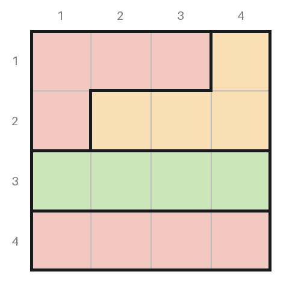</td><td></td></tr>
<tr id="dogdoku"><td>DogDoku</td><td>Queens rules with dogs: one dog per row, column and zone; dogs may not touch, even diagonally.</td><td><a href="../examples/dogdoku_5x5.txt">5 × 5</a> / <a href="../examples/dogdoku_7x7.txt">7 × 7</a> / <a href="../examples/dogdoku_9x9.txt">9 × 9</a></td><td></td><td></td></tr>
<tr id="sudoku-relations"><td>Sudoku relations</td><td>Sudoku, plus dots (white: differ by 1; black: one is double the other) and thermometers that rise from the bulb.</td><td><a href="../examples/sudoku_kropki_4x4.txt">4 × 4</a> / <a href="../examples/sudoku_relations_9x9.txt">9 × 9</a></td><td></td><td>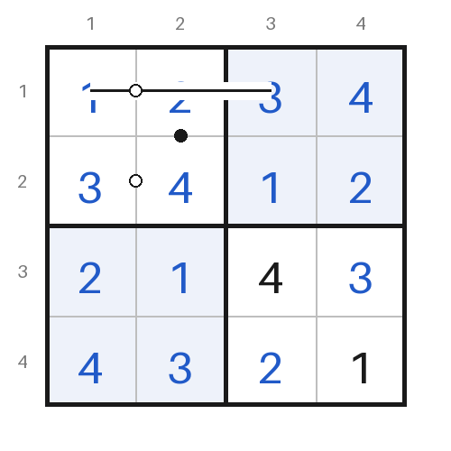</td></tr>
<tr id="anti-knight"><td>Anti-knight Sudoku</td><td>Sudoku, where equal digits may also not be a knight's move apart.</td><td><a href="../examples/sudoku_anti_4x4.txt">4 × 4</a> / <a href="../examples/sudoku_anti_9x9.txt">9 × 9</a></td><td>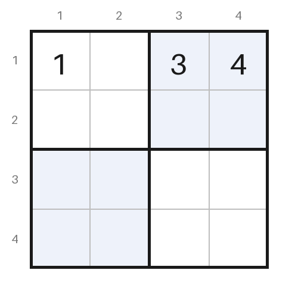</td><td></td></tr>
<tr id="anti-king"><td>Anti-king Sudoku</td><td>Sudoku, where equal digits may also not touch, even diagonally.</td><td><a href="../examples/sudoku_antiking_6x6.txt">6 × 6</a> / <a href="../examples/sudoku_antiking_9x9.txt">9 × 9</a></td><td>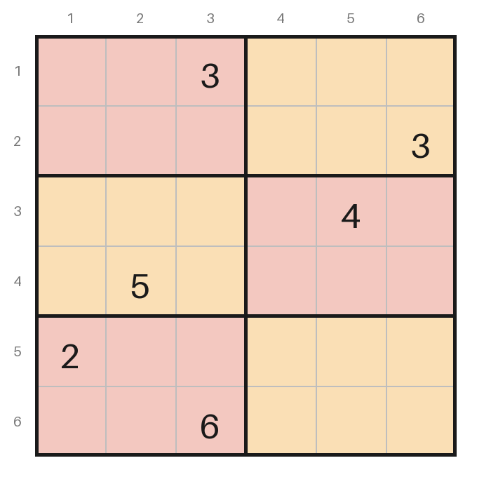</td><td></td></tr>
<tr id="suguru"><td>Tectonic / Suguru</td><td>Fill each region of n cells with 1 to n; equal digits may not touch, even diagonally.</td><td><a href="../examples/suguru_4x4.txt">4 × 4</a> / <a href="../examples/suguru_8x8.txt">8 × 8</a></td><td>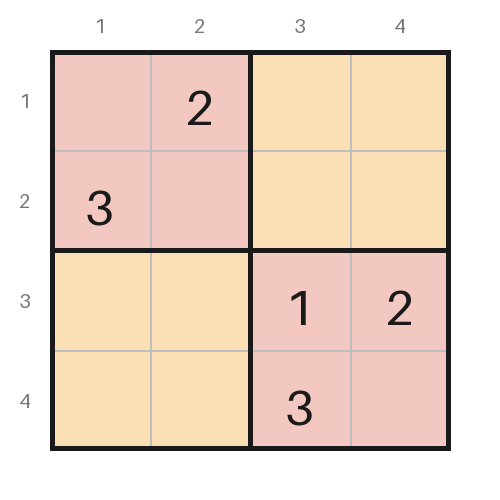</td><td></td></tr>
<tr id="star-battle"><td>Star Battle</td><td>Put 1, 2 or 3 stars in every row, column and region; stars may not touch, even diagonally.</td><td><a href="../examples/starbattle_8x8.txt">8 × 8</a> / <a href="../examples/starbattle_10x10.txt">10 × 10</a> / <a href="../examples/starbattle_12x12.txt">12 × 12</a></td><td></td><td></td></tr>
<tr id="zebra"><td>Zebra logic grid</td><td>Use the clues to match every item of each category to one position.</td><td><a href="../examples/logicgrid_3x3.txt">3 × 3</a> / <a href="../examples/logicgrid_6x6.txt">6 × 6</a></td><td>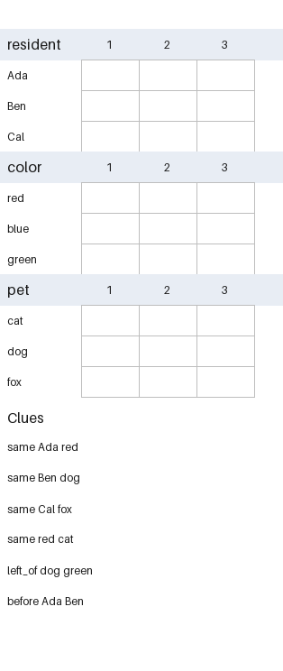</td><td></td></tr>
<tr id="binairo"><td>Binairo / Takuzu</td><td>Fill with 0 and 1: no three equal in a row, equal counts per line, no two identical lines.</td><td><a href="../examples/binairo_4x4.txt">4 × 4</a> / <a href="../examples/binairo_8x8.txt">8 × 8</a></td><td>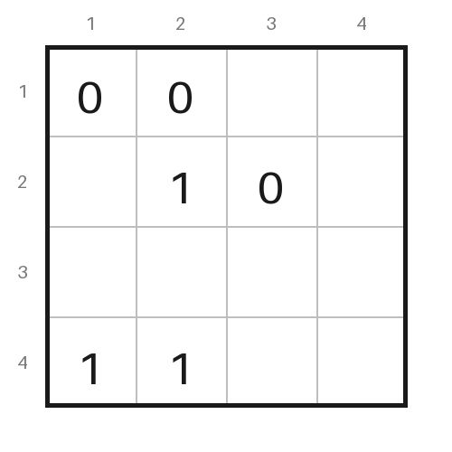</td><td></td></tr>
<tr id="tango"><td>Tango</td><td>Binairo rules plus = and × signs between neighbouring cells (equal or different).</td><td><a href="../examples/tango_4x4.txt">4 × 4</a> / <a href="../examples/tango_8x8.txt">8 × 8</a></td><td>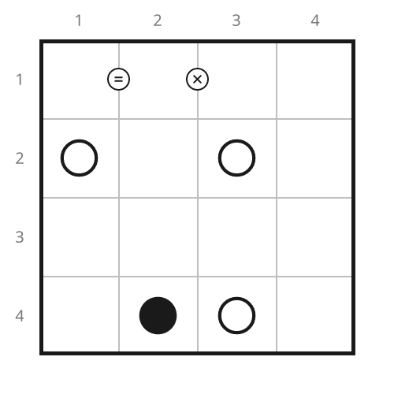</td><td></td></tr>
<tr id="tents"><td>Tents and Trees</td><td>One tent beside each tree (not diagonally); tents never touch; numbers count tents per line.</td><td><a href="../examples/tents_4x4.txt">4 × 4</a> / <a href="../examples/tents_8x8.txt">8 × 8</a></td><td>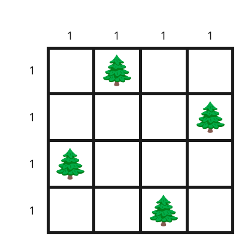</td><td></td></tr>
<tr id="minesweeper"><td>Minesweeper-style</td><td>Mark the mines: each number counts the mines among its eight neighbours.</td><td><a href="../examples/minesweeper_3x3.txt">3 × 3</a> / <a href="../examples/minesweeper_8x8.txt">8 × 8</a></td><td>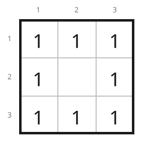</td><td></td></tr>
<tr id="akari"><td>Light Up / Akari</td><td>Light every white cell; bulbs may not see each other; numbers count adjacent bulbs.</td><td><a href="../examples/akari_2x2.txt">2 × 2</a> / <a href="../examples/akari_8x8.txt">8 × 8</a></td><td>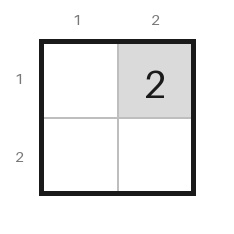</td><td></td></tr>
<tr id="kakurasu"><td>Kakurasu</td><td>Shade cells so each line adds up to its target; a shaded cell counts its position.</td><td><a href="../examples/kakurasu_4x4.txt">4 × 4</a> / <a href="../examples/kakurasu_8x8.txt">8 × 8</a></td><td></td><td></td></tr>
<tr id="battleships"><td>Battleships, counts only</td><td>Mark ship cells to match the row and column counts (no fleet or shapes).</td><td><a href="../examples/battleships_counts_4x4.txt">4 × 4</a> / <a href="../examples/battleships_counts_8x8.txt">8 × 8</a></td><td></td><td></td></tr>
</table>

## Rule-focused examples

The standard Sudoku set exercises `single`, `subsumption`, `cover2`, `cover3`, and `chains`. The 4 × 4 Queens example needs `what_if`; the Star Battle examples have irregular regions and grade `cover2` (8 × 8, two stars), `chains` (10 × 10, two stars) and `cover3` (12 × 12, three stars), and a two-star board cannot be smaller than 8 × 8, nor a three-star board smaller than 12 × 12; the logic grids and weighted Kakurasu examples exercise `relations`; the count-oriented examples exercise `count`. Run `--grade` for the exact grade of any individual example.

| Family | Small example | Larger example |
|---|---|---|
| Queens-style | `queens_4x4.txt` | `queens_8x8.txt` |
| DogDoku (grades `single`, `subsumption`, `cover2`) | `dogdoku_5x5.txt` | `dogdoku_7x7.txt`, `dogdoku_9x9.txt` |
| Sudoku relations | `sudoku_kropki_4x4.txt` | `sudoku_relations_9x9.txt` |
| Anti-knight Sudoku | `sudoku_anti_4x4.txt` | `sudoku_anti_9x9.txt` |
| Anti-king Sudoku | `sudoku_antiking_6x6.txt` | `sudoku_antiking_9x9.txt` |
| Tectonic / Suguru | `suguru_4x4.txt` | `suguru_8x8.txt` |
| Star Battle (2 and 3 stars) | `starbattle_8x8.txt` | `starbattle_10x10.txt`, `starbattle_12x12.txt` |
| Zebra-style logic grids | `logicgrid_3x3.txt` | `logicgrid_6x6.txt` |
| Binairo / Takuzu | `binairo_4x4.txt` | `binairo_8x8.txt` |
| Tango | `tango_4x4.txt` | `tango_8x8.txt` |
| Tents and Trees | `tents_4x4.txt` | `tents_8x8.txt` |
| Minesweeper-style | `minesweeper_3x3.txt` | `minesweeper_8x8.txt` |
| Light Up / Akari | `akari_2x2.txt` | `akari_8x8.txt` |
| Kakurasu | `kakurasu_4x4.txt` | `kakurasu_8x8.txt` |
| Battleships, counts only | `battleships_counts_4x4.txt` | `battleships_counts_8x8.txt` |

## Existing families

| Puzzle | Rules | Example coverage |
|---|---|---|
| Sudoku | Every row, column and box holds each digit once (jigsaw, NRC and X variants change the boxes). | `sudoku_4x4`, easy, pointing, naked/hidden pairs, X-Wing, Swordfish, chains, Jigsaw, NRC, X-Sudoku |
| Calcudoku | No repeats in a row or column; each cage's digits combine to its target with its operation. | 4×4 easy, 6×6 medium/hard/fiendish, and 7×7 hard |
| Futoshiki | No repeats in a row or column; every inequality sign between neighbouring cells holds. | 5×5 with no givens and eight inequality signs |
| Murdoku | Place each person on a free square, at most one per row and column, so all clues hold; the murderer is alone with the victim. | `murdoku_intro`, `murdoku_house`, `murdoku_sparse_mystery`, `murdoku_global_counts`, `murdoku_composition`, `food-murdoku-1/2/3`, `zoo-murdoku-1/2/3`, `tamagotchi-murdoku-6x6/9x9/12x12`, and owner-authored `prrrdoku1-3` |

The graded Sudoku and Calcudoku examples are generated; newspaper puzzles are not copied. `prrrdoku1-3` are based on the owner's Dutch puzzle documents, with adjustments to preserve the intended solution and late reveal. Private screenshot transcriptions are excluded from this repository.

## Cross-family benchmark

`uv run python benchmark/families.py --runs 3 --seed 42` measures parser, CLI load/compile, deduction solve, and independent brute-force times for every listed small/larger family example. The seed shuffles execution order; the checked-in, unique example files are fixed. The benchmark stops if an example is no longer unique or the engine disagrees with brute force.
