# Puzzle Examples

The checked-in example files are original, generated, or owner-authored. Published Sudoku, newspaper, and book puzzles are not transcribed here. Every tracked example is checked for a unique brute-force solution, engine agreement, and per-step soundness by the test suite.

## Quick commands

```bash
uv run csp examples/sudoku_1_4x4.txt
uv run csp examples/queens_4_4x4.txt --show-model
uv run csp examples/demo/murdoku_1_first_case.txt --explain
uv run csp examples/logicgrid_1_3x3.txt --brute-force
uv run csp examples/akari_1_6x6.txt --png
```

For each family example below, add `--png FILE.png` to write the puzzle image and a solved image named `FILE-solution.png`.

## First Murdoku case

Four people are placed on a 4 × 4 floor plan with three rooms. Trees, bushes, tables, and cabinets block cells; chairs and a bed are standable. The clues put Ingrid on a chair, Joost next to the tree, and Lotte on the bed. Wouter, the victim, occupies the last free square and is alone with Ingrid in the sitting room. The Dutch series also has a distinct 4 × 4 garden-party puzzle: [`wie-doet-het-met-wie-2.txt`](../examples/wie-doet-het-met-wie/wie-doet-het-met-wie-2.txt).

Murdoku examples live in category folders under `examples/` (for example `japanese-food/`, `dierentuin/`, `tamagotchi/`); the folder name is the category shown in the web player and the booklet, which groups and numbers the puzzles in a fixed order. Test-only puzzles live in `tests/puzzles/`. The files [`murdoku_1_first_case.txt`](../examples/demo/murdoku_1_first_case.txt), [`murdoku_3_house.txt`](../examples/demo/murdoku_3_house.txt), [`murdoku_sparse_mystery.txt`](../tests/puzzles/murdoku_sparse_mystery.txt), [`murdoku_global_counts.txt`](../tests/puzzles/murdoku_global_counts.txt), [`murdoku_composition.txt`](../tests/puzzles/murdoku_composition.txt), and [`murdoku_2_point_objects.txt`](../examples/demo/murdoku_2_point_objects.txt) cover the core clue syntax, relation reasoning, roles, global counts, composition of board features, and objects on grid points. The three Tamagotchi puzzles [`tamagotchi-murdoku-6x6.txt`](../examples/tamagotchi/tamagotchi-murdoku-6x6.txt) (simple, grade `relations`), [`tamagotchi-murdoku-9x9.txt`](../examples/tamagotchi/tamagotchi-murdoku-9x9.txt) (medium, grade `cover2`, with a stream and a bridge) and [`tamagotchi-murdoku-12x12.txt`](../examples/tamagotchi/tamagotchi-murdoku-12x12.txt) (hard, needs `what_if`) are original late-reveal cases: the devil Akumatchi has no clues of his own, is placed last, and is alone with exactly one friend. The three Japanese-food puzzles [`food-murdoku-2.txt`](../examples/japanese-food/food-murdoku-2.txt) (5×5, grade `chains`), [`food-murdoku-1.txt`](../examples/japanese-food/food-murdoku-1.txt) (6×6, `subsumption`) and [`food-murdoku-3.txt`](../examples/japanese-food/food-murdoku-3.txt) (7×7, needs `what_if`) use Japanese dishes as suspects and Japanese cities as areas. The three Dutch zoo puzzles [`zoo-murdoku-1.txt`](../examples/dierentuin/zoo-murdoku-1.txt) (5×5, grade `relations`), [`zoo-murdoku-2.txt`](../examples/dierentuin/zoo-murdoku-2.txt) (6×6, `subsumption`) and [`zoo-murdoku-3.txt`](../examples/dierentuin/zoo-murdoku-3.txt) (6×6, `cover2`) put animals in biomes with matching objects and colours. The three Dutch menu puzzles [`menu-murdoku-1.txt`](../examples/weekmenu/menu-murdoku-1.txt) (6×6, grade `relations`), [`menu-murdoku-2.txt`](../examples/weekmenu/menu-murdoku-2.txt) (7×7, `subsumption`) and [`menu-murdoku-3.txt`](../examples/weekmenu/menu-murdoku-3.txt) (8×8, needs `what_if`) put foods on the days of the week, with sunflowers and ornamental onions on grid points; the vla has no clues of its own and shares its day with exactly two other foods (`alone_with Vla 2`). The Dutch series *Wie doet het met wie?* starts with [`wie-doet-het-met-wie-1.txt`](../examples/wie-doet-het-met-wie/wie-doet-het-met-wie-1.txt) (5×5 sleepover, grade `cover2`): three bathrobes and three pairs of slippers lie at fixed squares, global counts say two guests stand on a bathrobe and one on slippers, and the clue "one bathrobe wearer is exactly one row above the slippers wearer" (`above object:badjas object:sloffen 1`) is needed to find who. It continues with [`wie-doet-het-met-wie-2.txt`](../examples/wie-doet-het-met-wie/wie-doet-het-met-wie-2.txt) (4×4 garden party, `subsumption`), [`wie-doet-het-met-wie-3.txt`](../examples/wie-doet-het-met-wie/wie-doet-het-met-wie-3.txt) (5×5 beach with sunglasses, `subsumption`), [`wie-doet-het-met-wie-4.txt`](../examples/wie-doet-het-met-wie/wie-doet-het-met-wie-4.txt) (6×6 house with a standable 2×2 double bed and glasses, `cover2`) and [`wie-doet-het-met-wie-5.txt`](../examples/wie-doet-het-met-wie/wie-doet-het-met-wie-5.txt) (7×7 hotel, `cover2`, where Wouter's partner wears a bathrobe: `alone_with Wouter object:badjas`). Every puzzle in the series puts bathrobes, slippers and (from the beach on) glasses on fixed squares, gives the number of wearers as rules, and needs a garment clue to find who wears what. Wouter has no clues, is placed last and is alone with exactly one other person (`alone_with Wouter`). The owner-authored Dutch puzzles are [`prrrdoku1.txt`](../examples/prrrdoku/prrrdoku1.txt), [`prrrdoku2.txt`](../examples/prrrdoku/prrrdoku2.txt), and [`prrrdoku3.txt`](../examples/prrrdoku/prrrdoku3.txt). The Dutch series *Moord in de Oriënt Express* puts the suspects in a train and on its platforms: [`murdoku_orient_express.txt`](../examples/murder-in-the-orient-express/murdoku_orient_express.txt) (8×8, grade `relations`), [`murdoku_orient_express_2.txt`](../examples/murder-in-the-orient-express/murdoku_orient_express_2.txt) (10×10 with a restaurant car, `subsumption`) and [`murdoku_orient_express_3.txt`](../examples/murder-in-the-orient-express/murdoku_orient_express_3.txt) (10×10, `chains`). On the 10×10 boards a row of rails (nobody can stand there) separates each platform from the train, and gangplanks lead to the doors. No clue names the murderer: the rules fix their sex, the crime scene and whether they were alone there, and the murderer is the last suspect left.

## Murder Hotel

The English Murder Hotel trilogy gives the guests Italian names and moves the mystery through the roof terrace, restaurant, guest rooms, and lobby. Each board has a guest corridor with doors into the room wings, a main staircase connecting the Lobby, guest corridor, and Restaurant, and a one-column lift along the east side that stops only at the Lobby and Restaurant. A street-side vestibule opens into the Lobby. The first two puzzles use a conventional crime-scene mystery; the final puzzle leaves the murderer as a separate role and asks the solver to identify the guest at the deduced position. Its body is at the base of the lift shaft. The 8×8 opener is grade `relations`; the 9×9 and 10×10 puzzles are grade `subsumption`. See [`murder-hotel-1.txt`](../examples/murder-hotel/murder-hotel-1.txt), [`murder-hotel-2.txt`](../examples/murder-hotel/murder-hotel-2.txt), and [`murder-hotel-3.txt`](../examples/murder-hotel/murder-hotel-3.txt).

## Halloween at the Museum

The English Halloween at the Museum series sets three costume-party murders in one museum, with a Spanish cast and painter rooms (Velázquez, Goya, El Greco) next to the armoury, the Egyptian and dinosaur halls and the gift shop. Every puzzle shares one rule: the murderer was in the room where the weapon lies. Each puzzle narrows the suspects with a trait (a woman, a guest in costume, a member of staff), and the murderer appears in no clue. The cursed dagger (6×6) and the crossbow (7×7) are grade `subsumption`; the candlestick (8×8) is grade `cover2`. See [`halloween-museum-1.txt`](../examples/halloween-museum/halloween-museum-1.txt), [`halloween-museum-2.txt`](../examples/halloween-museum/halloween-museum-2.txt), and [`halloween-museum-3.txt`](../examples/halloween-museum/halloween-museum-3.txt).

## New family gallery

These previews are generated from the example files. The root README keeps a compact all-family gallery; this page provides the expanded visual index, file inventory, and grading notes.

<table>
<tr><th>Family</th><th>Rules</th><th>Small / larger file</th><th>Puzzle</th><th>Solution</th></tr>
<tr id="queens"><td>Queens-style</td><td>One queen per row, column and colour region; queens may not touch, not even diagonally.</td><td><a href="../examples/queens_4_4x4.txt">4 × 4</a> / <a href="../examples/queens_2_8x8.txt">8 × 8</a></td><td></td><td>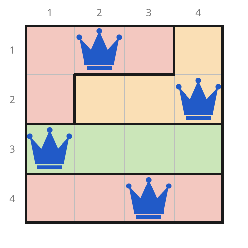</td></tr>
<tr id="dogdoku"><td>DogDoku</td><td>Queens rules with dogs: one dog per row, column and zone; dogs may not touch, even diagonally.</td><td><a href="../examples/dogdoku_1_5x5.txt">5 × 5</a> / <a href="../examples/dogdoku_2_7x7.txt">7 × 7</a> / <a href="../examples/dogdoku_3_9x9.txt">9 × 9</a></td><td>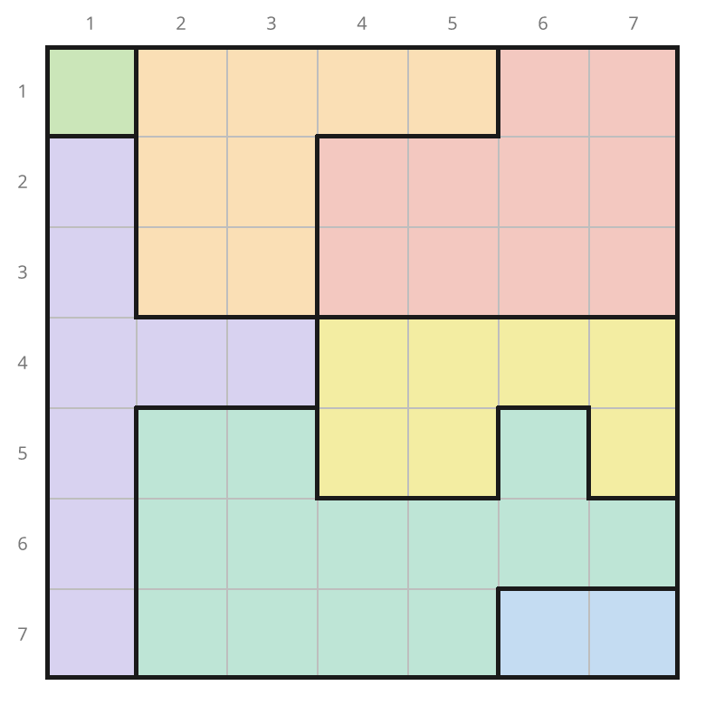</td><td></td></tr>
<tr id="sudoku-relations"><td>Sudoku relations</td><td>Sudoku, plus dots (white: differ by 1; black: one is double the other) and thermometers that rise from the bulb.</td><td><a href="../examples/sudoku_9_4x4_kropki.txt">4 × 4</a> / <a href="../examples/sudoku_7_9x9_relations.txt">9 × 9</a></td><td></td><td>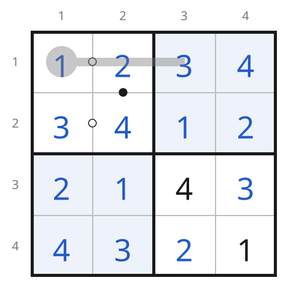</td></tr>
<tr id="anti-knight"><td>Anti-knight Sudoku</td><td>Sudoku, where equal digits may also not be a knight's move apart.</td><td><a href="../examples/sudoku_2_4x4_anti.txt">4 × 4</a> / <a href="../examples/sudoku_3_9x9_anti.txt">9 × 9</a></td><td>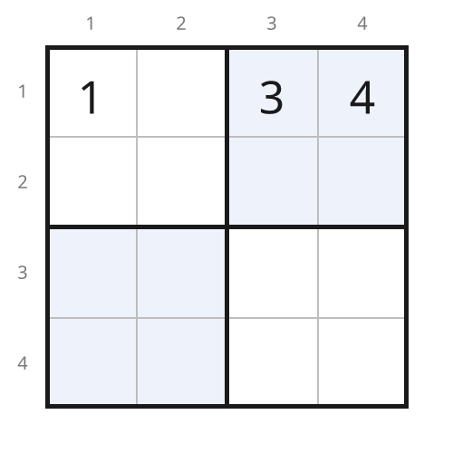</td><td>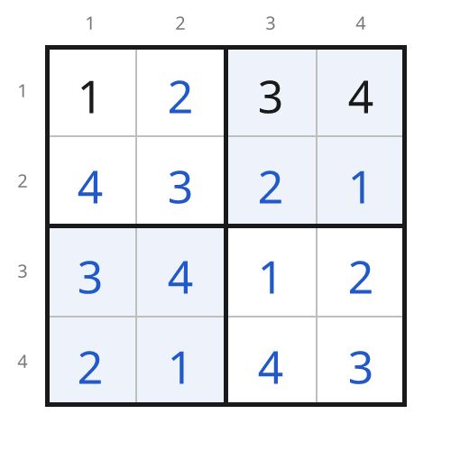</td></tr>
<tr id="anti-king"><td>Anti-king Sudoku</td><td>Sudoku, where equal digits may also not touch, even diagonally.</td><td><a href="../examples/sudoku_16_6x6_antiking.txt">6 × 6</a> / <a href="../examples/sudoku_4_9x9_antiking.txt">9 × 9</a></td><td>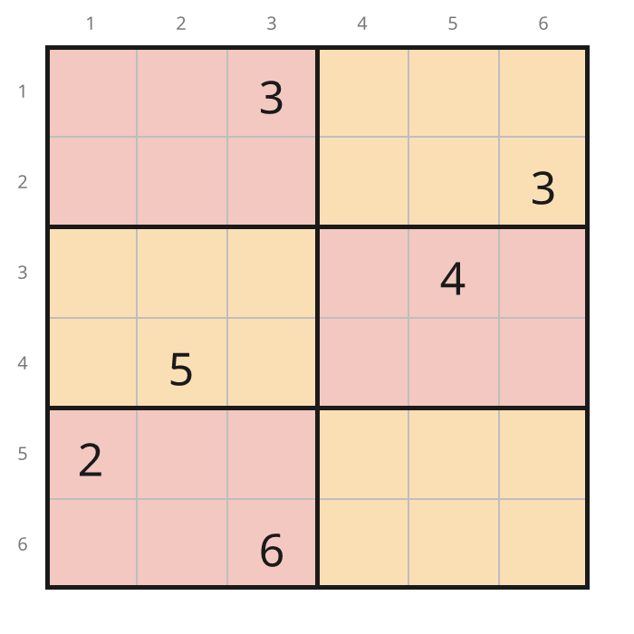</td><td></td></tr>
<tr id="suguru"><td>Tectonic / Suguru</td><td>Fill each region of n cells with 1 to n; equal digits may not touch, even diagonally.</td><td><a href="../examples/suguru_1_4x4.txt">4 × 4</a> / <a href="../examples/suguru_2_8x8.txt">8 × 8</a></td><td>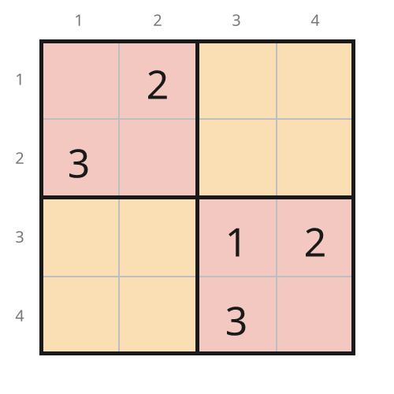</td><td>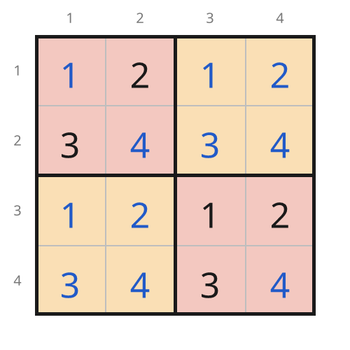</td></tr>
<tr id="star-battle"><td>Star Battle</td><td>Put 1, 2 or 3 stars in every row, column and region; stars may not touch, even diagonally.</td><td><a href="../examples/starbattle_2_8x8.txt">8 × 8</a> / <a href="../examples/starbattle_4_10x10.txt">10 × 10</a> / <a href="../examples/starbattle_3_12x12.txt">12 × 12</a></td><td>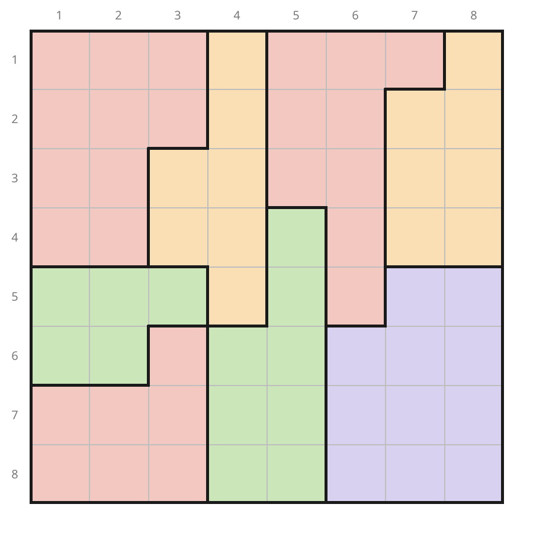</td><td>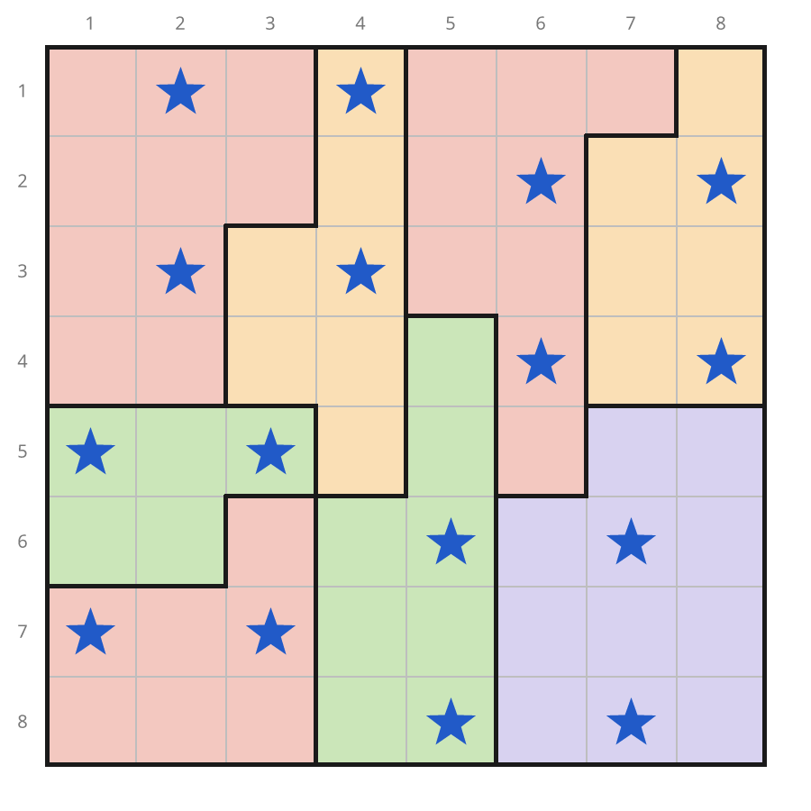</td></tr>
<tr id="zebra"><td>Zebra logic grid</td><td>Use the clues to match every item of each category to one position.</td><td><a href="../examples/logicgrid_1_3x3.txt">3 × 3</a> / <a href="../examples/logicgrid_2_6x6.txt">6 × 6</a></td><td>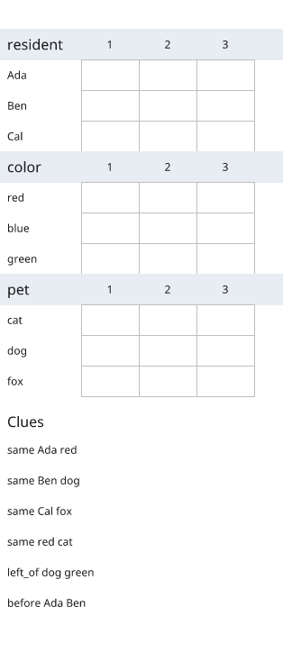</td><td>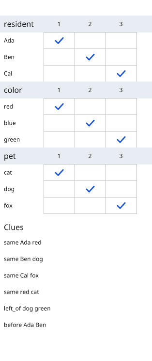</td></tr>
<tr id="binairo"><td>Binairo / Takuzu</td><td>Fill with 0 and 1: no three equal in a row, equal counts per line, no two identical lines.</td><td><a href="../examples/binairo_3_4x4.txt">4 × 4</a> / <a href="../examples/binairo_2_8x8.txt">8 × 8</a></td><td>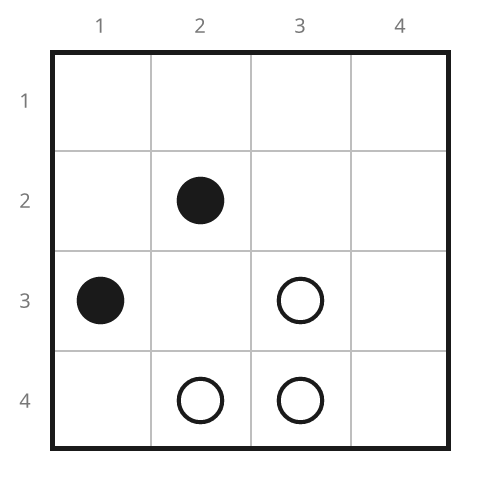</td><td></td></tr>
<tr id="tango"><td>Tango</td><td>Binairo rules plus = and × signs between neighbouring cells (equal or different).</td><td><a href="../examples/tango_2_4x4.txt">4 × 4</a> / <a href="../examples/tango_4_8x8.txt">8 × 8</a></td><td></td><td>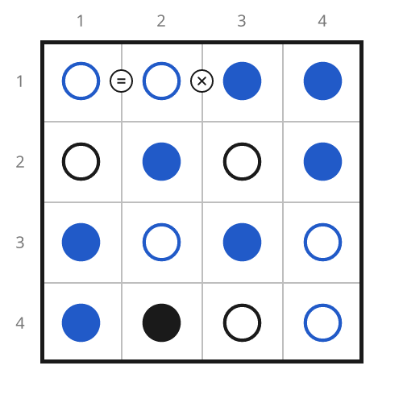</td></tr>
<tr id="tents"><td>Tents and Trees</td><td>One tent beside each tree (not diagonally); tents never touch; numbers count tents per line.</td><td><a href="../examples/tents_3_4x4.txt">4 × 4</a> / <a href="../examples/tents_1_8x8.txt">8 × 8</a></td><td></td><td>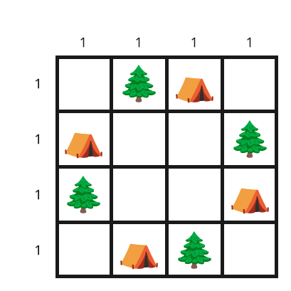</td></tr>
<tr id="minesweeper"><td>Minesweeper-style</td><td>Mark the mines: each number counts the mines among its eight neighbours.</td><td><a href="../examples/minesweeper_2_5x5.txt">5 × 5</a> / <a href="../examples/minesweeper_3_8x8.txt">8 × 8</a></td><td>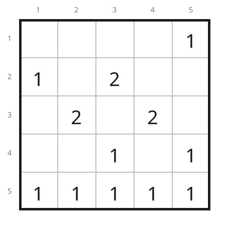</td><td>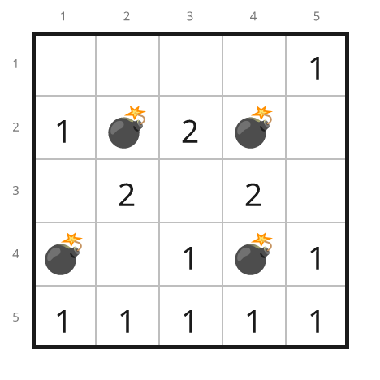</td></tr>
<tr id="akari"><td>Light Up / Akari</td><td>Light every white cell; bulbs may not see each other; numbers count adjacent bulbs.</td><td><a href="../examples/akari_1_6x6.txt">6 × 6</a> / <a href="../examples/akari_2_8x8.txt">8 × 8</a></td><td>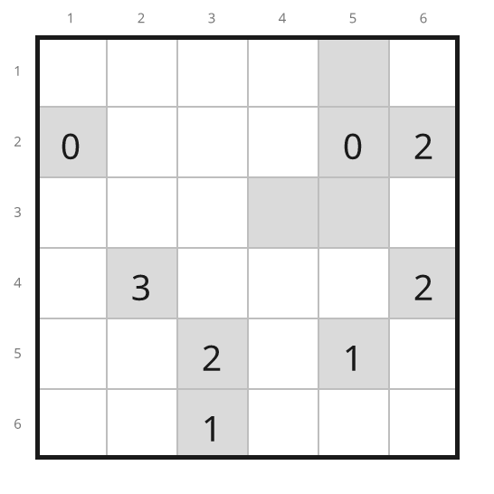</td><td>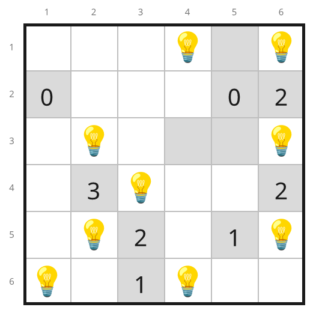</td></tr>
<tr id="kakurasu"><td>Kakurasu</td><td>Shade cells so each line adds up to its target; a shaded cell counts its position.</td><td><a href="../examples/kakurasu_1_4x4.txt">4 × 4</a> / <a href="../examples/kakurasu_2_8x8.txt">8 × 8</a></td><td>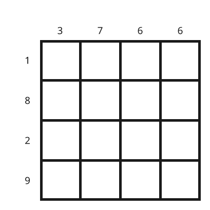</td><td>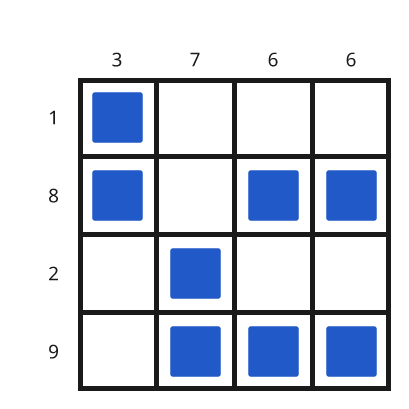</td></tr>
<tr id="battleships"><td>Battleships, counts only</td><td>Mark ship cells to match the row and column counts (no fleet or shapes).</td><td><a href="../examples/battleships_1_4x4_counts.txt">4 × 4</a> / <a href="../examples/battleships_2_8x8_counts.txt">8 × 8</a></td><td>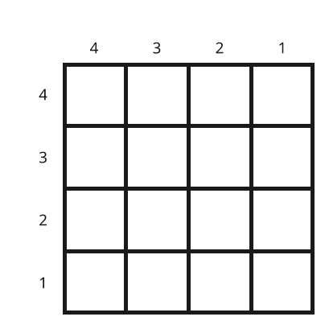</td><td>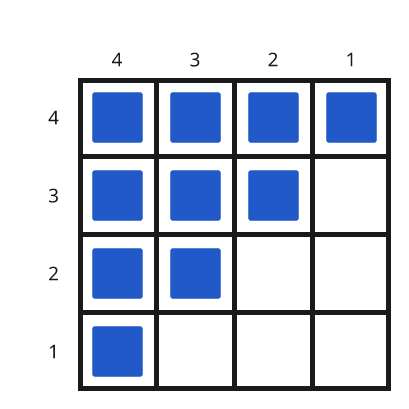</td></tr>
</table>

## Verified non-Murdoku difficulty examples

These tiers come from `puzzle-lab search examples --tier <easy|medium|hard>`.
Every listed file is deductively solved by the repository solver and has a
unique solution under independent search. The tier is an estimate for this
solver, not a universal measure of human difficulty. `—` marks a coverage gap:
the current generator/rule ladder has not produced a trustworthy example for
that family and tier, so no candidate is promoted by hand. Queens/DogDoku and
Binairo/Tango are listed separately because the gallery presents them as
distinct puzzle types.

| Puzzle type | Easy | Medium | Hard |
|---|---|---|---|
| Sudoku | [`sudoku_5_9x9.txt`](../examples/sudoku_5_9x9.txt) (`single`) | [`sudoku_13_9x9_naked_pair.txt`](../examples/sudoku_13_9x9_naked_pair.txt) (`cover2`) | [`sudoku_17_9x9_chains.txt`](../examples/sudoku_17_9x9_chains.txt) (`chains`) |
| Calcudoku | [`calcudoku_1_4x4.txt`](../examples/calcudoku_1_4x4.txt) (`relations`) | [`calcudoku_3_6x6.txt`](../examples/calcudoku_3_6x6.txt) (`relations`) | [`calcudoku_5_7x7.txt`](../examples/calcudoku_5_7x7.txt) (`cover3`) |
| Futoshiki | [`futoshiki_1_5x5.txt`](../examples/futoshiki_1_5x5.txt) (`single`) | [`futoshiki_2_5x5.txt`](../examples/futoshiki_2_5x5.txt) (`relations`) | [`futoshiki_3_5x5.txt`](../examples/futoshiki_3_5x5.txt) (`chains`) |
| Queens | [`queens_1_4x4.txt`](../examples/queens_1_4x4.txt) (`single`) | [`queens_3_7x7.txt`](../examples/queens_3_7x7.txt) (`cover2`) | [`queens_4_4x4.txt`](../examples/queens_4_4x4.txt) (`what_if`) |
| DogDoku | [`dogdoku_1_5x5.txt`](../examples/dogdoku_1_5x5.txt) (`single`) | [`dogdoku_2_7x7.txt`](../examples/dogdoku_2_7x7.txt) (`subsumption`) | [`dogdoku_4_4x4.txt`](../examples/dogdoku_4_4x4.txt) (`chains`) |
| Tectonic / Suguru | [`suguru_1_4x4.txt`](../examples/suguru_1_4x4.txt) (`single`) | — | [`suguru_2_8x8.txt`](../examples/suguru_2_8x8.txt) (`chains`) |
| Star Battle | [`starbattle_1_8x8.txt`](../examples/starbattle_1_8x8.txt) (`count`) | [`starbattle_2_8x8.txt`](../examples/starbattle_2_8x8.txt) (`cover2`) | [`starbattle_3_12x12.txt`](../examples/starbattle_3_12x12.txt) (`cover3`) |
| Zebra logic grid | [`logicgrid_1_3x3.txt`](../examples/logicgrid_1_3x3.txt) (`relations`) | [`logicgrid_2_6x6.txt`](../examples/logicgrid_2_6x6.txt) (`relations`) | — |
| Binairo / Takuzu | [`binairo_1_8x8.txt`](../examples/binairo_1_8x8.txt) (`relations`) | [`binairo_2_8x8.txt`](../examples/binairo_2_8x8.txt) (`subsumption`) | [`binairo_3_4x4.txt`](../examples/binairo_3_4x4.txt) (`what_if`) |
| Tango | [`tango_1_8x8.txt`](../examples/tango_1_8x8.txt) (`relations`) | [`tango_4_8x8.txt`](../examples/tango_4_8x8.txt) (`relations`) | [`tango_5_4x4.txt`](../examples/tango_5_4x4.txt) (`what_if`) |
| Tents and Trees | [`tents_1_8x8.txt`](../examples/tents_1_8x8.txt) (`single`) | [`tents_2_8x8.txt`](../examples/tents_2_8x8.txt) (`cover2`) | [`tents_3_4x4.txt`](../examples/tents_3_4x4.txt) (`what_if`) |
| Minesweeper-style | — | [`minesweeper_1_8x8.txt`](../examples/minesweeper_1_8x8.txt) (`subsumption`) | [`minesweeper_4_8x8.txt`](../examples/minesweeper_4_8x8.txt) (`cover3`) |
| Light Up / Akari | — | [`akari_1_6x6.txt`](../examples/akari_1_6x6.txt) (`subsumption`) | [`akari_2_8x8.txt`](../examples/akari_2_8x8.txt) (`chains`) |
| Kakurasu | [`kakurasu_1_4x4.txt`](../examples/kakurasu_1_4x4.txt) (`relations`) | [`kakurasu_2_8x8.txt`](../examples/kakurasu_2_8x8.txt) (`relations`) | — |
| Battleships, counts only | [`battleships_1_4x4_counts.txt`](../examples/battleships_1_4x4_counts.txt) (`count`) | [`battleships_2_8x8_counts.txt`](../examples/battleships_2_8x8_counts.txt) (`count`) | — |

The most visible gaps are Tectonic/Suguru, counts-only Battleships, Kakurasu,
and logic grids. In particular, the existing 8 × 8 Suguru file is
trivial, and is intentionally excluded. These gaps require stronger
family-specific deduction or generation support before a harder human-like
example can be claimed.

## Rule-focused examples

The standard Sudoku set exercises `single`, `subsumption`, `cover2`, `cover3`, and `chains`. The 4 × 4 Queens example needs `what_if`; the Star Battle examples have irregular regions and grade `cover2` (8 × 8, two stars), `chains` (10 × 10, two stars) and `cover3` (12 × 12, three stars), and a two-star board cannot be smaller than 8 × 8, nor a three-star board smaller than 12 × 12; the logic grids and weighted Kakurasu examples exercise `relations`; the count-oriented examples exercise `count`. Run `--grade` for the exact grade of any individual example.

| Family | Small example | Larger example |
|---|---|---|
| Queens-style | `queens_4_4x4.txt` | `queens_2_8x8.txt` |
| DogDoku (grades `single`, `subsumption`, `cover2`) | `dogdoku_1_5x5.txt` | `dogdoku_2_7x7.txt`, `dogdoku_3_9x9.txt` |
| Sudoku relations | `sudoku_9_4x4_kropki.txt` | `sudoku_7_9x9_relations.txt` |
| Anti-knight Sudoku | `sudoku_2_4x4_anti.txt` | `sudoku_3_9x9_anti.txt` |
| Anti-king Sudoku | `sudoku_16_6x6_antiking.txt` | `sudoku_4_9x9_antiking.txt` |
| Tectonic / Suguru | `suguru_1_4x4.txt` | `suguru_2_8x8.txt` |
| Star Battle (2 and 3 stars) | `starbattle_2_8x8.txt` | `starbattle_4_10x10.txt`, `starbattle_3_12x12.txt` |
| Zebra-style logic grids | `logicgrid_1_3x3.txt` | `logicgrid_2_6x6.txt` |
| Binairo / Takuzu | `binairo_3_4x4.txt` | `binairo_2_8x8.txt` |
| Tango | `tango_2_4x4.txt` | `tango_4_8x8.txt` |
| Tents and Trees | `tents_3_4x4.txt` | `tents_1_8x8.txt` |
| Minesweeper-style | `minesweeper_2_5x5.txt` | `minesweeper_3_8x8.txt` |
| Light Up / Akari | `akari_1_6x6.txt` | `akari_2_8x8.txt` |
| Kakurasu | `kakurasu_1_4x4.txt` | `kakurasu_2_8x8.txt` |
| Battleships, counts only | `battleships_1_4x4_counts.txt` | `battleships_2_8x8_counts.txt` |

## Existing families

| Puzzle | Rules | Example coverage |
|---|---|---|
| Sudoku | Every row, column and box holds each digit once (jigsaw, NRC and X variants change the boxes). | `sudoku_1_4x4`, easy, pointing, naked/hidden pairs, X-Wing, Swordfish, chains, Jigsaw, NRC, X-Sudoku |
| Calcudoku | No repeats in a row or column; each cage's digits combine to its target with its operation. | 4×4 easy, 6×6 medium/hard/fiendish, and 7×7 hard |
| Futoshiki | No repeats in a row or column; every inequality sign between neighbouring cells holds. | 5×5 with no givens and eight inequality signs |
| Murdoku | Place each person on a free square, at most one per row and column, so all clues hold; the murderer is alone with the victim. | `murdoku_1_first_case`, `wie-doet-het-met-wie-1/2/3/4/5`, `murdoku_3_house`, `murdoku_sparse_mystery`, `murdoku_global_counts`, `murdoku_composition`, `food-murdoku-2/2/3`, `zoo-murdoku-1/2/3`, `tamagotchi-murdoku-6x6/9x9/12x12`, and owner-authored `prrrdoku1-3` |

The graded Sudoku and Calcudoku examples are generated; newspaper puzzles are not copied. `prrrdoku1-3` are based on the owner's Dutch puzzle documents, with adjustments to preserve the intended solution and late reveal. Private screenshot transcriptions are excluded from this repository.

## Cross-family benchmark

`uv run python benchmark/families.py --runs 3 --seed 42` measures parser, CLI load/compile, deduction solve, and independent brute-force times for every listed small/larger family example. The seed shuffles execution order; the checked-in, unique example files are fixed. The benchmark stops if an example is no longer unique or the engine disagrees with brute force.
